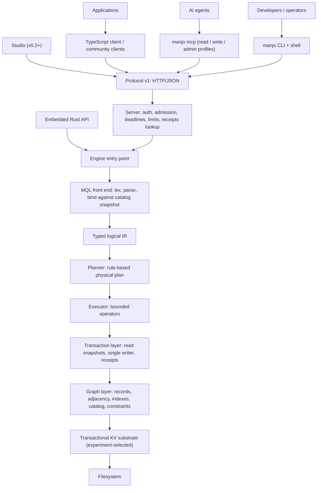
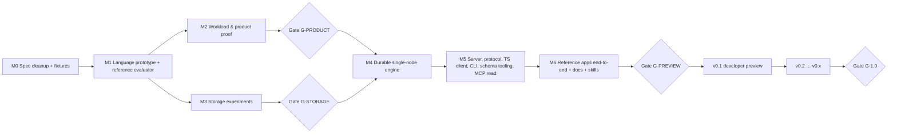

# GRAND PLAN — Building ManjoDB

> **ManjoDB — Relationships, first.**
>
> The architectural source of truth for ManjoDB: a single-node, graph-native database for applications that must answer *what is connected to what, and why*. This plan covers the product thesis, graph model, schema system, MQL, execution, storage, transactions, server protocol, SDKs, CLI, AI-native tooling, operations, testing, roadmap, and the research tracks that are deliberately *not* on the critical path.

**Revision:** 4.3 — 2026-11-15. Revision 4.3 adopts Nx as the monorepo tool (§5.4). Revision 4.2 (the same day) added competitive, scaling, and adoption research, and four small architecture proposals (listed below). Revision 4.1 (2026-10-03) made three language changes:

- MQL bindings are now declared name-first (`find dependency: Service`), and `as` only renames output columns.
- Default output keys are now `<binding>_<property>`.
- Existing objects are bound with a single `by` form.

The research is in [`research/mql-as-keyword.md`](research/mql-as-keyword.md) and the decision in §8.15. All examples, the grammar, and the fixture are updated.

Revision 4.1 also adds:

- the repository-structure research and seam rules ([`research/monorepo-structure.md`](research/monorepo-structure.md), §5.4);
- the confirmed all-open-source scope (§29);
- the brand identity (`brand/`, Commit Lanes).

Revision 4.2 adds:

- the competitive landscape, including OrientDB ([`research/competitive-landscape.md`](research/competitive-landscape.md));
- a staged scale-out path, and why single-node is a stage rather than a ceiling ([`research/scaling-path.md`](research/scaling-path.md), §28);
- the adoption strategy and a license candidate ([`research/developer-adoption-strategy.md`](research/developer-adoption-strategy.md), §29);
- proposals to keep scale-out open: a logical commit log (§10.2), `commit_seq` in results (§8.8), reserved partition bits in IDs (§6.2), and a distributed-substrate feasibility experiment (§10.6).

Revision 4.3 adds:

- **Nx as the monorepo tool** (confirmed 2026-11-15), replacing the earlier `justfile` plan. Nx enforces the seam rules with project tags, runs only affected projects in CI, and releases npm packages; Cargo stays the source of truth for Rust. The design, trade-offs, and open questions are in [`research/monorepo-structure.md`](research/monorepo-structure.md) §3.3–3.4;
- the main risks it records: Rust support comes from a community plugin, Rust crate releases through Nx are unverified, and Nx's per-target build directories may slow CI. Two M0 spikes (§25.2) measure them.

**Document status:** proposed architecture. **Implementation status:** nothing described here is implemented, released, benchmarked, or user-tested. Every command, package name, port, endpoint, configuration key, and MQL example is a proposed interface. Package names, domains, registry namespaces, and container repositories must be checked and secured before use.

## What changed in revision 4

Revision 4 is a critical architecture review and rewrite of revision 3 (196 numbered sections plus Appendices A–G). Substantive changes, each recorded with its rationale in Appendix H:

1. **Separated six milestones that revision 3 blurred:** language prototype, in-memory reference evaluator, storage experiments, durable single-node engine, developer preview, production engine. The cheap, high-risk questions (does MQL work, is there a product) now come before durable storage (§25).
2. **Replaced the custom page/WAL/buffer-pool engine with a graph layer over an embedded transactional key-value substrate** for v0.1. The candidate substrate is chosen by experiment (§10). A custom page store becomes a research track gated by measurements.
3. **Replaced the database-wide read/write lock with single-writer, snapshot-reader concurrency.** Reads no longer block writes, and the result is still serializable (§11).
4. **Removed interactive multi-request transactions from the remote protocol.** A write is one atomic document. Writes carry a request ID, and the server stores a write receipt in the same transaction, so a retry after an uncertain outcome is safe (§11.5, §13).
5. **Simplified the data model.** Each node has exactly one node type, fixed at creation. Nulls are not stored, so a property is either present or missing. Relationship types declare their allowed endpoint types (§6).
6. **Fixed MQL semantic defects.** Revision 3 had `!=` disagreeing with `not =`, numeric `=` disagreeing with `<=`/`>=`, and a null/missing distinction that query output could not show. MQL now uses SQL-standard three-valued logic and has one numeric comparison rule. Added `require` (in-transaction checks), lookup by unique key, and typed bindings for existing objects (§8).
7. **Designed the schema system.** It separates desired schema, runtime catalog, migration history, and observed shape. It has a language-neutral schema document, a code-first TypeScript front end, and server-computed migration plans (§7).
8. **Made the CLI one Rust binary** (`manjo`), which contains the server, admin tools, shell, and MCP server. TypeScript is kept for the client and the schema DSL.
9. **Added an AI-native architecture.** It has machine-readable contracts, read/write/admin MCP profiles with a preview-then-apply write flow, agent skills, LLM-readable documentation, an LLM authoring evaluation, and a verified distribution plan. AI has no bypass path (§18).
10. **Confronted the question "why not GQL/Cypher?"** directly. MQL remains a hypothesis with explicit kill criteria (§8.12), and the engine IR is independent of the front-end language.
11. **Defined product hypotheses with rejection criteria.** One of the evaluated outcomes is "do not build a database" (§1, §26).
12. **Narrowed the official SDKs to TypeScript first and Python second.** Other languages are protocol-plus-conformance community tiers until there is a maintainer (§14).
13. **Collapsed** Studio (12 sections), website/docs (8), Cloud/distributed (13), and performance ideas (7) into scoped sections and research tracks. Removed the study list from the architecture.
14. **Revised the reference fixture and every example** to the revision-4 language.

## How to read this document

**Status tags.** Every capability carries one tag. The tag describes *planning* status. Nothing is implemented.

| Tag | Meaning |
| --- | --- |
| **[Core]** | Part of the minimum coherent product. Removing it breaks the thesis or the safety model. |
| **[v0.1]** | Required for the developer preview. |
| **[v0.2+]** | Planned after the preview. Semantics may already be sketched, but are not frozen. |
| **[1.0]** | Required before stable compatibility promises. |
| **[Experiment]** | A question that a named experiment answers. The design depends on the result. |
| **[Research]** | Unresolved problem with no committed delivery. |
| **[Ecosystem]** | Optional integration outside the engine. |
| **[Deferred]** | Explicitly not planned. May never happen. |

**Evidence rules.** A claim about an external system cites a source in Appendix G. A claim about ManjoDB's behavior is a *requirement* or a *hypothesis*, never a result. No benchmark, usability study, adoption, or customer result exists. Wherever the text says "measure", the measurement has not been run.

**Canonical answers.** Each architectural question has one home section. Other sections cross-reference it (for example "see §11.5") and do not restate it. If two passages ever disagree, the home section wins and the disagreement is a defect.

**Reading routes.** Product and adoption: §1–§4 and Appendix D. Language: §8 and Appendices A, C, and E. Engine: §9–§12. Integration: §13–§18. Delivery: §25–§28.

---

# Part I — Why ManjoDB, and how much of it

## 1. Product thesis

### 1.1 The problem

Many applications must answer questions about connected entities, such as:

- "If this service fails, what is affected?"
- "Which dashboards depend on this column?"
- "Why does this user have access?"
- "What evidence supports this claim?"

The questions share four traits:

- **Variable depth:** the number of hops is not known in advance.
- **Directionality:** depends-on versus depended-on-by.
- **Evidence:** the answer must show *which* relationships produced it, not just a yes/no or a list of IDs.
- **Mutable inventories:** the relationships change continually and are often sourced from several systems.

Today teams typically answer these questions in one of four ways:

- recursive SQL ([P1]);
- closure tables or application-side traversal code;
- a specialized product (service catalogs, lineage tools, authorization services);
- a general graph database.

### 1.2 The bet

"Relationships are first-class" is an architectural property, not a product advantage. ManjoDB's bet is narrower and testable:

> For relationship-heavy *explanation* workloads, such as impact, lineage, provenance, and access explanation, a small, single-binary graph database with an explicit query language, evidence-preserving results, and enforced graph integrity can deliver correct answers with less application code and fewer correctness bugs than a well-built relational implementation. It can also be operated with an acceptable added burden, usually as a **rebuildable projection** beside the system of record.

The bet has four parts, and each one can fail independently:

| ID | Hypothesis | Measured by | Rejected or narrowed if |
| --- | --- | --- | --- |
| **H1 — Expressiveness** | The v0.1 language and path API express the reference workloads (Appendix D) without application-side traversal loops. | Task coverage on the reference query corpus; count of application traversal stages. | More than a small minority of reference tasks need client-side loops or multiple round trips that a recursive CTE expresses in one query. |
| **H2 — Correctness and comprehension** | Developers, and LLMs that have a validator, write *correct* MQL for the reference tasks at least as reliably as recursive SQL or a Cypher/GQL subset. | Usability study and LLM authoring evaluation (Appendix C). | MQL is not at least comparable on correctness, especially on direction and multiplicity tasks. |
| **H3 — Integrity value** | Enforced endpoint types, deletion rules, and unique keys prevent classes of relationship bugs that relational baselines leave to application code. | Bug-injection exercise on the reference apps: count the invalid states each implementation accepts. | The relational baseline with ordinary FKs, constraints, and triggers prevents the same states at comparable effort. |
| **H4 — Operational acceptability** | Teams will run ManjoDB as a projection: one binary, one data directory, rebuild from source. | Pilot interviews; measured rebuild time, sync lag, and on-call burden. | Pilot teams consistently refuse an extra stateful process for this workload. |

Performance is **not** part of the core bet. ManjoDB must be *adequate* on the reference workloads (Appendix D gives indicative scales). It does not need to be faster than PostgreSQL. A speed claim requires a benchmark (§23).

### 1.3 Target developer and first workload

- **First developer:** a backend or platform engineer who owns an inventory of services, datasets, permissions, or evidence. That data already lives in PostgreSQL, YAML, or event streams. The engineer currently maintains traversal code or recursive SQL to answer impact and explanation questions.
- **First workload:** dependency impact (Appendix D1).
- **Second workload:** data lineage (Appendix D2).
- Both are read-heavy, write-moderate, have variable depth, and need evidence.

### 1.4 Primary store versus projection

**Projection first.** The expected first deployment is a *rebuildable projection*. An existing system remains authoritative, and ManjoDB is loaded and kept current by an importer or sync process (§16).

This decision lowers the adoption cost: there is no data migration and no single point of truth at risk. It also orders priorities:

- import, replay, and idempotency come early;
- multi-request interactive transactions come late.

Primary-store use is supported once the durable engine meets its 1.0 criteria (§25.4). Before 1.0, documentation must say plainly that a projection can always be rebuilt from its source, and that a primary store depends entirely on ManjoDB's durability and backups.

### 1.5 Honest alternatives

The table below names, for each situation, the option that can be enough and what ManjoDB must beat to be worth adopting.

| Situation | An existing option that can be enough | What ManjoDB must beat |
| --- | --- | --- |
| Variable-depth traversal over a modest graph | PostgreSQL recursive CTEs with indexes and cycle handling [P1] | Query authoring correctness, evidence output, integrity enforcement; not raw speed |
| Fixed-hop relationship loading | Joins, eager loading, projections [P2] | Nothing, unless graph integrity or evidence matters |
| Authorization checks | A dedicated relationship-based authorization service [P5] | ManjoDB does **not** compete as an enforcement engine (§2) |
| Data lineage | OpenLineage-based tooling [P4] | ManjoDB can be a store *behind* such tooling, not a replacement |
| Another graph database (Neo4j, ArcadeDB, Memgraph, others) | Mature products; Neo4j leads the graph category | Narrow job, continuity, and trust: see [`research/competitive-landscape.md`](research/competitive-landscape.md). Not breadth or raw speed |
| Embedded analytical graph queries | Embedded graph engines; note that the Kùzu repository was archived in October 2025 [R10] | Long-term maintainability and a focused scope. Sustainability is a product requirement, not an afterthought. |
| Large-scale graph analytics | Dedicated analytics frameworks, or exporting to NetworkX/igraph | Not a v0.1–1.0 goal (§28) |

**Alternative evaluated at the product gate:** *do not build a database.* Instead, ship MQL plus a compiler to recursive SQL over a user-owned PostgreSQL schema. That option avoids an extra stateful process (H4). However, it reintroduces exactly the problem PostgreSQL's SQL/PGQ review exposed: a graph interpretation over independently mutable tables, with lifecycle, dependency, and restore hazards (Appendix B). The product gate (§26) compares the two options on evidence.

## 2. Non-goals

ManjoDB, through 1.0, is **not**:

- a general-purpose replacement for a relational database, a document store, or OLAP;
- an authorization/policy engine. It can *store and explain* relationship evidence; enforcement belongs to a policy service;
- a vector database or a RAG framework. Vector candidates come from external indexes (§28);
- a distributed, replicated, or multi-region database *before 1.0*. Single node is the first stage of a path, not a ceiling: the staged path and the choices that keep it open are in §28 and [`research/scaling-path.md`](research/scaling-path.md);
- a graph-analytics platform. Only bounded reachability and shortest-path are in the core (§9.7);
- a blob or document store. Property values are bounded scalars (§6.4);
- a GraphQL server, or a Cypher/GQL-compatible endpoint (§8.12);
- an in-process plugin host (§21).

**Do not use ManjoDB when:**

- the workload is CRUD with fixed joins;
- relationships are few and shallow;
- reporting and aggregation dominate;
- you need multi-node high availability today;
- running another stateful process is unacceptable. Use recursive SQL instead.

## 3. Target workloads

The reference workloads drive every v0.1 capability. Full scenarios, models, queries, and acceptance checks are in **Appendix D**.

| Priority | Workload | What it forces the design to support |
| --- | --- | --- |
| **1** | Dependency impact (D1) | Incoming traversal; bounded reachability with witness paths; unique business keys; cycles; parallel evidence edges; import/replay |
| **2** | Data lineage (D2) | Typed multi-hop chains with alternating relationship roles; job-versus-run identity; late and duplicate events; staleness reporting |
| 3 | Access explanation (D3) | Evidence queries over memberships and grants; explicit non-enforcement boundary |
| 3 | Evidence-backed agent memory (D6) | Provenance chains; retraction; untrusted text stored as data |
| Later | Recommendations, entitlements, staffing, entity resolution, fraud, task scheduling (D4, D5, D7–D10) | Expose future requirements (aggregation, optional matches, anti-existence, guarded claims). They do **not** drive v0.1. |

Indicative proving scales for experiments (§10.6, §23):

| Graph | Nodes | Edges |
| --- | --- | --- |
| Small | 10^4 | 10^5 |
| Medium | 10^6 | 10^7 |

At both scales: power-law degree, hubs up to 10^5–10^6 incident edges, cycles, and parallel edges. Larger scales come after the substrate experiment.

## 4. Scope classification

This table is the canonical scope list. Section bodies elaborate, but must not contradict it.

| Capability | Classification | Home |
| --- | --- | --- |
| Directed property multigraph; typed IDs; one node type per node; endpoint-typed relationship types | **Core / v0.1** | §6 |
| Schema document, catalog, constraints (required, unique, endpoints), migrations | **Core / v0.1** | §7 |
| MQL v0.1 reads and write documents; `require`; unique-key lookup | **Core / v0.1** | §8 |
| In-memory reference evaluator (kept permanently as test oracle) | **Core / prototype** | §9.1, §22 |
| Bounded reachability and unweighted shortest path API | **v0.1** | §9.7 |
| Graph layer over embedded transactional KV substrate | **v0.1** ([Experiment] chooses the substrate) | §10 |
| Single writer with snapshot readers; write receipts / idempotent retry | **Core / v0.1** | §11 |
| Type-scan, unique, and equality indexes on declared properties | **v0.1** | §12 |
| HTTP/JSON protocol v1, token auth, capability manifest | **v0.1** | §13 |
| `manjo` Rust binary: server, CLI, shell, check, backup | **v0.1** | §14, §17 |
| TypeScript client and schema DSL | **v0.1** | §14 |
| Embedded Rust API | **v0.1** (unstable API) | §14.6 |
| Read-only MCP profile; agent skills; llms.txt; machine-readable contracts | **v0.1** ([Ecosystem], experimental label) | §18 |
| Native snapshot backup; logical export/import; integrity checker | **v0.1** | §17 |
| Import CLI with mappings, validation-only mode, resumable chunks | **v0.1** | §16 |
| MQL language server, formatter, query codegen | **v0.2+** | §14.5 |
| Optional follows, `order by`, `count` / grouped aggregates | **v0.2+** | Appendix E |
| Write and admin MCP profiles (preview → apply) | **v0.2+** | §18.4 |
| Python client | **v0.2+** | §14.1 |
| Studio (database IDE) | **v0.2+** | §15 |
| Upsert / bulk merge; parallel-edge prohibition constraint; degree constraints | **v0.2+** ([Experiment]) | §7, §16 |
| Interactive multi-request transactions over the network | **[Research]** — only if pilots demand them | §11.6 |
| Fine-grained (per-node/edge) authorization | **[Research]** | §19 |
| Outbound CDC / change feed | **1.0 candidate** | §16.5 |
| In-place storage-format upgrades | **1.0** (export/import before then) | §17.5 |
| Go/JVM/.NET and other SDKs | **[Ecosystem]**: community until a maintainer exists | §14.1 |
| Graph analytics (components, PageRank, centrality) | **[Research]**; export to existing tools | §28 |
| Custom page store, buffer pool, WAL | **[Research]**, gated by §10.7 triggers | §10.7 |
| Native vector index, temporal/versioned graph queries | **[Research]** | §28 |
| Replication, HA, managed Cloud, partitioning | **[Research]**: separate products | §28 |
| In-process plugins, GPU, SIMD, Bloom filters, neighborhood caches | **[Deferred]** until profiling demands | §21, §28 |
| GraphQL adapter, Cypher/GQL front end | **[Deferred]** / decided by §8.12 | §8.12 |

---

# Part II — Architecture

## 5. System architecture and boundaries

### 5.1 Layers and responsibilities



| Layer | Owns | Must not |
| --- | --- | --- |
| Clients (SDK, CLI, MCP, Studio) | Ergonomics, local validation, rendering | Implement query semantics, enforce security, or hold database locks |
| Protocol | Request/response shapes, value encoding, errors, capabilities (§13) | Vary by client language |
| Server | Authentication, roles, admission control, deadlines, cancellation, resource limits, audit events | Parse or plan queries itself, or touch storage directly |
| Front end | Tokens, AST with spans, name binding against one catalog snapshot, typing, diagnostics, query signatures | Read data or mutate anything |
| Planner/executor | Physical operators, budgets, deterministic ordering, result shaping | Bypass the transaction layer |
| Transaction layer | Snapshot lifetime, writer admission, commit, receipts, catalog-epoch checks | Expose partial state |
| Graph layer | Encodings, adjacency, indexes, constraint checks, catalog objects, integrity invariants (§22.1) | Depend on the server, MQL syntax, or clients |
| Substrate | Atomic durable commit, page management, crash recovery, MVCC read snapshots | Be visible above the graph layer (it must be replaceable) |

### 5.2 One mutation pipeline

Every change follows one path, whatever its source: MQL write documents, schema migrations, imports, sync appliers, MCP writes, embedded API calls, and restores of logical exports.

1. Parse the request.
2. Bind it against the catalog.
3. Authorize it.
4. Lower it to the write IR.
5. Acquire the writer.
6. Execute the steps inside one substrate write transaction.
7. Run deferred constraint checks.
8. Write the receipt.
9. Commit.
10. Release the writer and respond.

There is **no privileged importer, no admin backdoor, and no AI-specific path**. The embedded API skips only transport and authentication. Logical restore uses the same graph-layer write functions, run in bulk mode, and still validates every invariant.

### 5.3 Process and binary model

- `manjo` is **one Rust binary**. It contains the server (`manjo serve`), the CLI, the interactive shell, offline administration (`check`, `backup`, `restore`), and the MCP adapter (`manjo mcp`). Shipping one binary removes CLI/server version skew, as well as the npm-downloads-a-binary packaging problem that revision 3's TypeScript CLI created.
- A data directory is owned by exactly one process at a time, enforced by an exclusive OS lock. Offline commands refuse to run while a server owns the directory. Online equivalents go through the server.
- The TypeScript packages are libraries: the protocol client and the schema DSL. They never open a data directory.

### 5.4 Repository layout (proposed)

```text
nx.json                Nx workspace configuration (tags, targets, caching, release), over pnpm and Cargo workspaces
crates/manjo-core      IDs, values, encodings shared by all crates
crates/manjo-mql       lexer, parser, binder, IR, diagnostics, signatures
crates/manjo-ref       in-memory reference evaluator (test oracle)
crates/manjo-graph     graph layer over the KV substrate; catalog; constraints
crates/manjo-engine    planner, executor, transactions, receipts, paths
crates/manjo-server    HTTP protocol v1, auth, limits
crates/manjo           the `manjo` binary (CLI, shell, serve, mcp)
crates/xtask           repo automation in Rust (codegen, release checks)
packages/client        @manjodb/client  (TypeScript)
packages/schema        @manjodb/schema  (TypeScript schema DSL → schema document)
spec/                  grammar, protocol (OpenAPI), JSON Schemas, error registry,
                       capability registry, conformance fixtures, query corpus
skills/                agent skills (§18.5)
examples/              reference applications (Appendix D)
bench/                 benchmark harness and baselines (§23)
rfcs/                  accepted and proposed RFCs
docs/                  documentation source (also generates llms.txt)
research/              research notes
brand/                 logo files, brand sheet, generator (build_logo.py)
```

The repository is one **Nx monorepo** (confirmed 2026-11-15) until a seam earns its own repo. A **seam** is a directory boundary planned in advance as a possible future repository: the engine (`crates/`), the TypeScript surface, `spec/`, `skills/`, and `docs/`. The seam rules, tooling, split triggers, and extraction playbook are in [`research/monorepo-structure.md`](research/monorepo-structure.md). In summary:

- no cross-seam source imports;
- cross-seam dependencies only through built artifacts;
- Nx project tags enforced as module boundaries, per-seam changelogs, CODEOWNERS, and `nx affected` CI;
- Cargo stays the source of truth for Rust, and Nx orchestrates it through the community `@monodon/rust` plugin or plain run-commands targets;
- the engine crates never split;
- non-TypeScript SDKs start in their own repos and consume `spec/` conformance by version.

Start with fewer crates if that keeps interfaces easier to change. Dependencies point one way: clients → protocol → server → engine → graph → substrate. `spec/` is the contract every implementation is tested against.

## 6. Graph data model

### 6.1 The model

ManjoDB stores a **directed property multigraph**:

- **Nodes.** Each node has exactly one **node type** (the familiar "label"). The type is fixed when the node is created.
- **Edges (relationships).** Each edge has exactly one **relationship type**, a source node, and a target node. Direction is part of the stored edge.
- **Parallel edges and self-loops are legal** unless the relationship type forbids them (§7.3).
- **Properties** are named, typed scalar values on nodes and edges.

**Why a single type per node (changed from revision 3's multi-label nodes).** None of the reference workloads needs multiple labels. Multiple labels make almost everything ambiguous:

- schema enforcement, when two labels declare the same property differently;
- the meaning of a closed schema across a label union;
- endpoint constraints, unique scopes, code generation, and the meaning of "remove label".

A single fixed type gives a node a clear schema, a natural type-scan partition, static checking of `follow ... to Type`, and generated types that map 1:1 to the schema. Role-like tagging can be modeled with a property or a relationship. Multiple labels or traits may return through an RFC once a workload needs them **[v0.2+ Research]**.

### 6.2 Identity

- `NodeId` and `EdgeId` are distinct `u64` newtypes, allocated from separate monotonic counters. **IDs are never reused.** The counters are persisted in the same transaction as the allocation. **Candidate (needs RFC-0001):** reserve the top 12 bits of each ID as a *partition field*, zero until sharding exists, so a later sharded stage can allocate IDs per partition without renumbering. It leaves about 4.5 × 10^15 IDs per partition and costs nothing today (§28).
- IDs are scoped to a database UUID, generated at `manjo init`. An ID from one database is meaningless in another. Logical export/import preserves IDs (§17.4).
- Physical location is never identity.
- On the wire, IDs are decimal strings (§13.4). Node and edge IDs are different kinds: comparing one with the other is a validation error, even when the digits match.
- **Business identity is separate from database identity.** A source key such as a service slug is an ordinary property with a unique constraint (§7.3). Applications that store ManjoDB IDs externally must accept that a projection rebuilt *without* ID preservation assigns new IDs. Projections should therefore join on business keys.

### 6.3 Multiplicity

An edge is an object, not a fact about a pair of nodes. Two `DEPENDS_ON` edges between the same services are two pieces of evidence, and queries return both unless the query deduplicates explicitly (§8.6). `connect` always creates a new edge. A type can opt into forbidding parallel edges (§7.3); for such a type, a duplicate `connect` is a constraint error, never a silent merge.

### 6.4 Values

| Kind | Range / rules |
| --- | --- |
| Boolean | `true`, `false` |
| Int | Signed 64-bit. Overflow is an error, never a wrap. |
| Float | Finite IEEE-754 binary64. NaN and ±infinity are rejected. **−0.0 is normalized to +0.0 on write.** |
| String | Valid UTF-8, stored byte-exact with no Unicode normalization. Maximum size is a configured limit (proposed default 64 KiB). ManjoDB is not a blob store. |

**There is no stored null (changed from revision 3).** A property is either *present* with a value of its kind, or *missing*.

- `set p.x = …` requires a non-null value.
- `clear p.x` removes the property.
- A JSON `null` in a result means "missing".

Revision 3 distinguished stored null from missing in predicates, but projected both as JSON null. The distinction was therefore unobservable in results, invisible to SDKs, and a constant source of `is null`-versus-`is missing` confusion. Neo4j uses the same rule: setting a property to null removes it [R16].

Timestamps, byte arrays, lists, and vectors are later, versioned value kinds **[v0.2+]**. Until then, timestamps are stored as Int UTC milliseconds by convention, with the unit stated in the schema description.

### 6.5 Reserved metadata

The following read-only names are available in queries:

- **On nodes:** `_id`, `_type`.
- **On edges:** `_id`, `_type`, `_from`, `_to`.

User property names may not start with `_`. Metadata can be read, but not written with `set` or `clear`.

### 6.6 Deletion semantics

| Operation | Behavior |
| --- | --- |
| Delete a node that has incident edges | **Rejected** (RESTRICT) |
| `remove node x with edges` | Deletes the node and every incident edge atomically, counted against the write budget |
| Remove an edge | Removes only that edge; both endpoints remain |
| Change a node's type or an edge's endpoints | **Not supported.** Delete and recreate. |
| Drop a property declaration, index, or type | Catalog operation with dependency rules (§7.6) |

## 7. Schema, catalog, and migrations

### 7.1 Four different things

Revision 3 used "schema" for several different things. Revision 4 separates them:

| Concept | What it is | Where it lives | Authoritative for |
| --- | --- | --- | --- |
| **Desired schema** | The schema the developer wants | Schema document in the application repo, authored directly or generated from TypeScript | Intent |
| **Runtime catalog** | The schema the database enforces, at a catalog epoch | Inside the database, versioned transactionally with data | Enforcement |
| **Migration history** | The ordered, reviewed plans that took the catalog from one epoch to the next | Migration files in the repo, plus applied-migration records in the database | Reproducibility and audit |
| **Observed shape** | Statistics about what the data actually contains | Computed on demand from the catalog and data | Diagnostics only. **Never a constraint.** |

### 7.2 Schema document (the language-neutral contract)

The canonical desired-schema format is a versioned JSON document (`manjo.schema.json`), validated by a published JSON Schema (`spec/schema-document.schema.json`).

**Why JSON as the canonical form:**

- It is language-neutral, so every SDK and agent can produce and read it.
- It is easy to diff and to validate.
- The server, not a client library, computes migration plans from it.

**What ships for authoring:**

- **TypeScript code-first DSL (`@manjodb/schema`) [v0.1].** Gives typed schema authoring and inferred TypeScript types for the first target audience.
- **Hand-written JSON [v0.1].** Acceptable for non-TypeScript users and agents; validated by the JSON Schema.
- **Other language DSLs [Ecosystem].** They emit the same document.
- **MQL DDL [Deferred].** MQL stays a data language in v0.1. Adding `define`-style statements would create a second schema spelling and mix DDL into data documents. Reconsider only if users demand it.

Shape (illustrative):

```json
{
  "$schema": "https://manjodb.dev/schema-document/v1.json",
  "format": 1,
  "nodeTypes": {
    "Service": {
      "properties": {
        "key":  {"kind": "string", "unique": true},
        "name": {"kind": "string"},
        "tier": {"kind": "int", "optional": true}
      },
      "undeclared": "reject"
    },
    "Team": {"properties": {"key": {"kind": "string", "unique": true}, "name": {"kind": "string"}}}
  },
  "relationshipTypes": {
    "DEPENDS_ON": {
      "endpoints": [{"from": "Service", "to": "Service"}],
      "properties": {
        "environment": {"kind": "string"},
        "source": {"kind": "string"},
        "observed_at_ms": {"kind": "int"}
      }
    },
    "OWNS": {"endpoints": [{"from": "Team", "to": "Service"}], "parallel": "forbid"}
  }
}
```

(The domain `manjodb.dev` is a placeholder until it is owned.)

### 7.3 What a schema can declare

| Declaration | Meaning | Status |
| --- | --- | --- |
| Node type | A name; a node has exactly one type | **v0.1** |
| Relationship type plus endpoint pairs | Allowed `(from type, to type)` pairs, checked on every `connect` | **v0.1** |
| Property `kind` | Boolean, Int, Float, or String; checked on every write | **v0.1** |
| Required (default) / `optional` | A required property must be present at the end of every write document | **v0.1** |
| `unique` | At most one node of the type has a given present value. Implies an index. Missing values do not participate. | **v0.1** (node properties only) |
| `index` | Equality index on a declared property | **v0.1** |
| `undeclared: "reject" \| "allow"` | Whether properties not in the schema may be stored (default `reject`) | **v0.1** |
| `parallel: "forbid"` | At most one edge of this type per (source, target) pair | **v0.2+ [Experiment]** (cost measured in §10.6) |
| Degree / cardinality limits (for example "at most one OWNS per Service") | Maximum in- or out-degree per type | **v0.2+ [Experiment]** |
| Defaults, computed properties, views | — | **[Deferred]**. Computed objects create the dependency and restore hazards documented in Appendix B. |
| Composite unique keys | — | **v0.2+**. Until then, encode a collision-free canonical string (Appendix D1). |

**Required by default.** Making properties required unless marked optional prevents the most common schema mistake in ORMs, forgetting to mark a column NOT NULL. **`undeclared: "reject"` by default.** A typo in a property name then fails loudly, instead of silently creating a new property. `undeclared: "allow"` exists for exploratory types. Undeclared properties cannot be indexed or constrained, and they are typed `unknown` in query signatures.

**Constraint timing.** Constraints are **deferred to the end of the write document** and checked inside the same transaction. A document can therefore `add` a node and `set` its required properties in later steps. Violations abort the whole document. The error names the object, the constraint, and the source span of the step that last touched the object.

### 7.4 Code-first TypeScript schema

The design goal is Drizzle-like ergonomics [R15] (the schema lives in application code, and types are inferred), without relational concepts. Endpoints are part of a relationship type's definition, not a foreign-key afterthought.

```ts
import { defineSchema, node, relationship, string, int } from "@manjodb/schema";

export const Team = node("Team", {
  key: string().unique(),
  name: string(),
});

export const Service = node("Service", {
  key: string().unique(),
  name: string(),
  tier: int().optional(),
});

export const Owns = relationship("OWNS", {
  from: Team,
  to: Service,
  // parallel: "forbid",  // v0.2+ candidate
});

export const DependsOn = relationship("DEPENDS_ON", {
  from: Service,
  to: Service,
  properties: {
    environment: string(),
    source: string(),
    observed_at_ms: int(),
  },
});

export default defineSchema({ nodes: [Team, Service], relationships: [Owns, DependsOn] });
```

Rules:

- The DSL is a *pure emitter*. `manjo-schema emit` evaluates the module and writes `manjo.schema.json`. It does not connect to a database.
- Endpoints given as arrays (`from: [Job, Run]`) produce the cross product of pairs.
- Renames are expressed explicitly in migrations (§7.5), not inferred by the DSL.
- `InferNode<typeof Service>` and `InferRelationship<typeof DependsOn>` give TypeScript types for typed write helpers. Typed *query results* come from query signatures (§14.5), not from guessing.

### 7.5 Commands and workflow

All plans are **computed by the server** from (desired document, live catalog). Only the server knows which changes need data validation, which are metadata-only, and which are destructive.

| Command | What it does | Why it exists |
| --- | --- | --- |
| `manjo schema pull` | Writes the live catalog as a schema document (optionally as a TypeScript skeleton) | Adopt an existing database; review drift |
| `manjo schema diff` | Prints the plan to move the live catalog to the desired document. Each step is classified *metadata-only*, *validating* (scans data, may fail), or *destructive* (loses data). | Review before acting |
| `manjo schema generate <name>` | Writes the plan as a numbered migration file, `manjo/migrations/0007_<name>.json`. The file holds steps, the expected source epoch, and a checksum. | Reviewed, versioned changes |
| `manjo migrate status` / `manjo migrate apply` | Applies pending migration files in order. Each migration is one atomic catalog transaction. Refuses if the live epoch is not the file's expected source epoch, or if an applied migration's checksum changed. | Reproducible deployment |
| `manjo schema push` | Diff and apply without a file. **Development databases only**: refuses when the database is marked `environment = "production"` and refuses destructive steps unless `--accept-data-loss`. | Fast local iteration |
| `manjo schema check` | For CI: verifies that the migration files reproduce the desired document, and optionally that a target database is at the expected epoch with no drift | Catch drift before deploy |

**Destructive steps** include dropping a type or property that has data, or removing an endpoint pair that edges use. They require an explicit acknowledgement inside the migration file. They are never applied by `push` without the flag, and never through MCP (§18.4).

**Changes that need data** follow an expand/contract pattern, because ManjoDB has no defaults:

- **Adding a required property to a populated type:** add it as optional, backfill with write documents, then make it required. The last step is a *validating* step that fails atomically if any node lacks the property.
- **Changing a property's kind:** not supported in place. Add a new property, backfill, drop the old one.
- **Renaming a type or property:** a metadata-only step, because names are interned to stable catalog IDs. It must be written explicitly in the migration (`{"op": "rename_property", …}`), since a diff cannot distinguish a rename from drop-plus-add. `generate` flags likely renames for review.

**Large validations** hold the single writer while they scan. They run under a migration budget. If the budget is exceeded, the migration aborts with the count of examined objects, and nothing is published. Online background validation is **[v0.2+ Research]**.

### 7.6 Catalog objects, dependencies, and epochs

- Catalog objects have typed, stable IDs: node type, relationship type, property declaration, endpoint pair, index, unique constraint, and migration record. Every operation validates the object's kind.
- **Dependencies are recorded at the granularity actually used.** An index depends on one property declaration. An endpoint pair depends on two node types. A relationship type with edges depends on its endpoint types. Dropping a depended-on object is RESTRICT. CASCADE is **[Deferred]**; when introduced, it must report the full affected set and commit atomically.
- There are no stored views or computed properties, so there are no dependency cycles to reconstruct at restore.
- **The catalog epoch** is a counter incremented by every committed catalog change, stored in the same substrate transaction as the change.
  - A query binds against the catalog of the snapshot it executes on, so binding and execution cannot disagree (§11.2).
  - Prepared plans carry the epoch they were bound at, and re-bind when it differs.
  - Plans also carry the authorization scope; a change in privileges forces re-authorization.
- Schema changes and data writes serialize through the same single writer. A concurrent read sees either the old catalog with the old data, or the new catalog with the new data.

### 7.7 Observed shape

`manjo schema observe` and the `describe` endpoint report counts per type, endpoint pairs actually present, property presence ratios for `undeclared: "allow"` types, and degree distributions (§10.5). Observed shape helps typo hints, autocomplete, and agents. It is labeled "observed" everywhere and never feeds enforcement.

---

## 8. MQL — Manjo Query Language

This section is the semantic contract for the MQL front end. The v0.1 grammar, the reference fixture, and diagnostic examples are in **Appendix A**. Future profiles are in **Appendix E**. The evidence and the usability plan are in **Appendix C**.

### 8.1 Design principles

1. **Every hop names its source, its relationship type, its direction word, and its destination type.** There is no implicit "current node", no arrow punctuation, and no method chain.
2. **Bindings are explicit, declared name-first (`name: Type`), and stay visible** until the end of the query.
3. **One canonical spelling per operation.** There are no synonyms (`get`/`fetch`/`select`) and no shorthand forms.
4. **Line-oriented clauses that map to plan operators.** Each clause has a visible counterpart in `explain` (§9.6).
5. **Semantics before surface.** Multiplicity, missing values, ordering, and budgets are specified. The sentence-like syntax does not hide them.

The v0.1 vocabulary has 32 reserved words:

- **Reads:** `find`, `where`, `follow`, `through`, `to`, `from`, `as`, `show`, `distinct`, `take`, `after`.
- **Writes:** `write`, `end`, `add`, `node`, `edge`, `by`, `connect`, `set`, `clear`, `require`, `remove`, `with`, `edges`.
- **Predicates:** `and`, `or`, `not`, `is`, `missing`, `present`, `true`, `false`.

Each word has one meaning:

- `with` appears only in `remove node x with edges`.
- `as` appears only in `show`, where it renames an output column.

Bindings are declared with one punctuation mark, the colon: `name: Type`. The reasons for that choice are in §8.15.

### 8.2 Reads

```mql
find dependency: Service
where dependency.key = $service_key
follow dependency through link: DEPENDS_ON from consumer: Service
follow consumer through OWNS from owner: Team
show consumer._id, consumer.name, owner.name, link._id
take 50
```

| Clause | Meaning |
| --- | --- |
| `find a: T` | Exactly one, first. Binds `a` to every node of type `T`. Logically a type scan; the planner may seek through an index (§9.4). |
| `where P` | Keeps the binding records for which `P` is **true**. May appear after `find` or after any `follow`. May refer only to aliases already bound. |
| `follow a through [e:] R to b: T` | For each record and each *stored* edge of type `R` whose **source** is `a` and whose target has type `T`, extends the record with `e` (if named) and `b`. |
| `follow a through [e:] R from b: T` | The same, for edges whose **target** is `a` and whose source has type `T`. |
| `show [distinct] field [as name], …` | Projects properties into output records. Exactly one, after all `find`/`where`/`follow` clauses. The default output key is `<binding>_<property>` (§8.8). `as` gives a custom name. |
| `take n [after $cursor]` | Optional, last. Returns at most `n` final rows (default 100, maximum 1,000). |

**Static checks against the schema.**

- `R` must allow the pair (type of `a`, `T`) in the stated direction. Otherwise the error says what the schema allows, for example "OWNS goes from Team to Service; you wrote `from Service`".
- Properties must be declared, unless the type allows undeclared properties.
- Comparison operand kinds must be compatible (§8.5).

### 8.3 The binding model

Execution state is a sequence of **binding records**, for example `{dependency: NodeId, link: EdgeId, consumer: NodeId, owner: NodeId, _e2: EdgeId}`. An edge alias may be omitted, but the edge still exists internally, as `_e2` above, for multiplicity and ordering. This notation describes engine state; it is not MQL syntax.

- `follow` may start from **any** earlier node binding. Two `follow`s from the same binding form branches. Their results multiply (a cross product per source record), and `explain` shows the fan-out.
- Every alias introduced by `find`/`follow` is new. Different aliases **may bind the same underlying node or edge**: naming does not imply distinctness. To require equality or inequality, compare IDs: `where reached._id = person._id` closes a cycle, and `where peer._id != person._id` excludes the start.
- A `follow` with no matching edge removes the input record (inner semantics). Keeping unmatched records requires the v0.2 optional follow (Appendix E1).
- Reusing an existing alias as a `follow` endpoint is **[v0.2+]**. Under the binding syntax it would be written as a bare name with no type, `... to friend`, which v0.1 rejects. In v0.1, express the same thing with an ID-equality `where`, so there is one way to say it.

### 8.4 Direction

`to` and `from` describe the **stored** edge relative to the source binding:

- `follow a through R to b: T` matches edges `a → b`;
- `follow a through R from b: T` matches edges `b → a`.

The source binding is always the exploration starting point, and the stored direction of an edge never changes. Either-direction traversal is **[v0.2+]** and will need its own word; there is no silent undirected interpretation. The usability study treats direction errors as critical (Appendix C2).

### 8.5 Predicates and three-valued logic

**Changed from revision 3**, which made comparisons with missing values *false* and let `not` turn them true. Under that rule `x != 1` and `not (x = 1)` disagreed on missing `x`, which is an inconsistency developers would hit in practice. MQL now uses Kleene three-valued logic, as SQL, Cypher, and GQL do:

- A comparison involving a missing property, or values of incomparable kinds at runtime, is **unknown**.
- `and`, `or`, and `not` follow the Kleene truth tables.
- `where` and `require` accept only **true**.
- `is missing` and `is present` are never unknown.

| `x` stored state | `x = 1` | `x != 1` | `not (x = 1)` | `x is missing` | `x is present` |
| --- | --- | --- | --- | --- | --- |
| missing | unknown | unknown | unknown | true | false |
| `1` | true | false | false | false | true |
| `2` | false | true | true | false | true |

To include missing values, say so: `where x != 1 or x is missing`.

**Comparison rules.**

| Operands | `=` / `!=` | `<` `<=` `>` `>=` |
| --- | --- | --- |
| Int with Int, Float with Float, Int with Float | Exact mathematical comparison: `1 = 1.0` is true, with no rounding. | Exact mathematical comparison |
| String with String | Byte-exact (no normalization, no case folding) | Unicode code-point order, identical to UTF-8 byte order; no locale collation |
| Boolean with Boolean | Supported | Rejected statically |
| NodeId with NodeId, or EdgeId with EdgeId | Supported | Supported (numeric ID order) |
| NodeId with EdgeId, or an ID with a scalar | Rejected statically | Rejected statically |
| Any other mixed kinds | Rejected statically when known; **unknown** at runtime (possible only with undeclared properties) | Same |

Revision 3 made `=` type-strict but ordered comparisons lossless, so `x <= 1 and x >= 1` could be true while `x = 1` was false. One numeric rule removes that inconsistency.

**Other predicate rules.**

- A literal or parameter may not be compared with `null`; there is no `null` literal (§6.4).
- At one parenthesis level, mixing `and` and `or` is rejected until the user adds parentheses. Users therefore never need to memorize precedence.
- `not` applies to the immediately following atom or parenthesized group.
- A predicate cannot introduce a binding.

### 8.6 Multiplicity and `distinct`

Every matching edge produces its own binding record. Parallel edges produce separate rows, and so do repeated paths to the same node.

`show distinct` deduplicates **projected tuples**, not graph objects. Two values are equal for `distinct` when they compare equal under `=`, or when both are missing. Among equal tuples, the first in default order is kept. To deduplicate entities, include their `_id`: `show distinct friend._id, friend.name` keeps different people who share a name.

### 8.7 Deterministic order and pagination

**Default order.** Binding records are ordered lexicographically by the tuple (root `NodeId`, then each `follow`'s `EdgeId` in textual clause order, including anonymous edges). Edge IDs determine their endpoints, so this tuple is unique per record, and the order is a pure function of the database state. With the adjacency layout in §10.3, this order falls out of index order at no extra cost. Any plan that reorders work (§9.5) must restore it.

**Paging.** `take n` applies after matching, filtering, projection, and `distinct`. It does not limit starting nodes, and it does not limit neighbors per node.

`take n after $cursor` resumes after the last binding tuple of the previous page. The cursor is opaque. It is bound to:

- the database UUID;
- the language profile;
- the fingerprint of the normalized query text without its `after` clause;
- the parameter values other than the cursor itself.

A cursor is not an authorization token: every page is authorized independently.

**Each page reads a fresh snapshot.** This is keyset pagination, so a row cannot appear twice and a row's position never shifts. Rows inserted before the cursor position are not seen, and rows deleted after it disappear. The guarantee is "no duplicates, no skips relative to the order key", not snapshot continuity. Snapshot-pinned paging is **[Research]**, because a long-lived snapshot retains old storage pages (§11.2).

**`distinct` with `after` is rejected in v0.1.** A truncated distinct page reports `has_more: true` with `cursor: null` and `continuation: "unsupported_distinct"`. The v0.2 `order by` makes distinct continuation well defined: the cursor is the last projected tuple (Appendix E2).

**`has_more`.** The executor looks for one additional qualifying record within budget. If it cannot determine whether one exists within the request's limits, the request fails with a budget error rather than guessing.

### 8.8 Result contract

The response below is for `show friend._id, friend.name, k._id as edge_id, k.since` on the Appendix A3 fixture. `as edge_id` is a custom name; every other key is a default.

```json
{
  "rows": [
    {"friend_id": "2", "friend_name": "Alice", "edge_id": "7", "k_since": 2025},
    {"friend_id": "2", "friend_name": "Alice", "edge_id": "8", "k_since": 2026}
  ],
  "columns": [
    {"name": "friend_id", "kind": "node_id"},
    {"name": "friend_name", "kind": "string", "nullable": false},
    {"name": "edge_id", "kind": "edge_id"},
    {"name": "k_since", "kind": "int", "nullable": true}
  ],
  "page": {"limit": 20, "has_more": false, "cursor": null, "continuation": "none"},
  "meta": {"snapshot": "s-81231", "catalog_epoch": 14, "examined_edges": 4}
}
```

- **Rows are flat records.**
- **Default output keys.** The default key is `<binding>_<property>`. Metadata drops its leading underscore: `friend._id` becomes `friend_id`, and `k._type` becomes `k_type`.
  - Binding names are unique, so default keys never collide across bindings. Every default key is also a valid identifier in the SDK languages, which matters for code generation (§14.5).
  - **Rare collision:** a user property literally named `id` projected alongside `_id` on the same binding. That is a binding error that suggests `as`.
- **`as` renames a column.** `show friend.name as name` gives a custom key, which must also be unique.
- **Keys do not depend on context.** Adding a binding to a query never renames existing columns.
- **`columns` comes from the query signature** (§14.5). It states each column's kind and whether it can be missing.
- **`continuation`** is one of `"cursor"`, `"none"`, or `"unsupported_distinct"`.
- **A request either returns a complete, correct page or fails.** Budget exhaustion is an error, never a success-shaped partial result.
- `meta.snapshot` identifies the read snapshot for diagnostics only. It does not promise that snapshot can be replayed later.
- `meta.commit_seq` is the monotonic sequence number of the latest commit visible to the read. Write receipts carry the `commit_seq` of their own commit. It is always satisfied on a single node, and it exists so that replicas can later honor a "read at least this commit" request without a protocol change (§28).
- Nested document output is **[v0.2+ Research]**.

### 8.9 Write documents

A write is one **document**: `write`, then steps, an optional `show`, and `end`. It executes sequentially in **one transaction** and is all-or-nothing.

```mql
write
  node consumer: Service by key = $consumer_key
  node dependency: Service by key = $dependency_key
  connect consumer through link: DEPENDS_ON to dependency
  set link.environment = $env, link.source = "deploy-manifest", link.observed_at_ms = $now
  show link._id
end
```

| Step | Meaning |
| --- | --- |
| `add x: T` | Creates a node of type `T`. `x` is bound to its new ID. |
| `node x: T by _id = $id` / `node x: T by _id = "42"` | Binds an existing node by ID. Fails with `not_found` if absent, or `wrong_type` if the node is not of type `T`. |
| `node x: T by k = v` | Binds an existing node by a **declared unique property** `k`. Fails with `not_found` if no node matches. Non-unique properties are rejected statically. `by _id` is the special case where `k` is the node's ID. |
| `edge e: R by _id = $id` | Binds an existing edge by ID, with the same type check. |
| `connect a through e: R to b` | Creates a new edge `a → b` of type `R`. The edge alias is required. The endpoint pair is checked against the schema. |
| `set x.p = v, …` | Assigns non-null values. The kind is checked against the declaration. |
| `clear x.p, …` | Removes properties. Clearing a missing property is a no-op. Clearing a required property fails at the deferred check. |
| `require P` | Evaluates `P` against the transaction's current state, including earlier steps. If it is not true, the whole document aborts with a typed `requirement_failed` conflict that names the statement. |
| `remove edge e` / `remove node x [with edges]` | Deletes. A removed alias cannot be used later. |
| `show …` | Optional and last. Projects one row from the surviving bindings. |

**`require` replaces revision 3's separate guarded-update design.** Compare-and-set is an ordinary predicate checked in the same transaction as the update:

```mql
write
  node task: Task by _id = $task_id
  require task.status = "ready" and task.revision = $expected_revision
  set task.status = "claimed", task.claimed_by = $worker, task.revision = $next_revision
end
```

Two workers cannot both claim the task. The second one fails with `requirement_failed`, and nothing is written. The revision property is application data. The engine does not maintain hidden revision counters.

**Write receipts.** Every write response includes:

- the request ID and commit status;
- the snapshot of the committed state;
- created, updated, and removed counts per type;
- the IDs of created objects;
- the `show` row, if any.

Receipts are stored durably to make retries safe (§11.5).

**Not in v0.1:**

- set-based writes (`find … set …` over many matches);
- upsert, which is planned as an explicit `v0.2+` step with create-only, update-only, and merge semantics;
- conditional branches inside documents;
- changing an edge's endpoints or type.

Bulk changes go through import (§16) or many bounded documents. Write budgets are in §9.8.

### 8.10 Parameters

- Parameters (`$name`) are passed separately from the query text and are **never interpolated** into it.
- A parameter's kind comes from its context: a declared property's kind, an ID context such as `_id` or a binding by ID, or the tagged wire value (§13.4).
- **Mismatches fail before execution.** For example, passing a Float to an Int property is rejected. An Int passed where a Float is expected is accepted only if it converts exactly.
- **Null parameters are rejected**, with the hint "use `clear`" or "use `is missing`".
- Missing and unused parameters are errors.
- List parameters (`in $keys`) are **[v0.2+]**, with defined size limits.

### 8.11 Errors and diagnostics

Every diagnostic has:

- a stable code from the error registry (`spec/errors.json`, §13.6);
- a category;
- the primary source span, plus related spans;
- a short message stating what is wrong and how to fix it;
- a docs link.

The front end reports the first real error and suppresses cascades. It never silently corrects a misspelled name, and it never reverses a direction.

```text
MANJO-Q1004 line 3, col 8: "freind" is not bound.
  Bound node aliases here: person, friend.
  help: did you mean "friend"?
```

```text
MANJO-Q2011 line 2, col 32: OWNS does not connect Service → Team.
  Schema allows: Team → Service.
  help: from a Service, use "follow service through OWNS from owner: Team".
```

More examples are in Appendix A4. Making the diagnostics understandable is a goal that will be tested, not assumed [L4].

### 8.12 Distinctiveness, and the GQL question

**The uncomfortable fact.** ISO/IEC 39075:2024 (GQL) is an international standard for property-graph querying [R1]. Cypher, from which much of GQL descends, has years of users, documentation, and LLM training data. MQL has none of these. A new query language is a large adoption cost, and it is a direct cost for AI-native use, because models have no pretraining exposure to it.

**What MQL hypothesizes in exchange:**

- Each hop is a self-contained clause that reads as a sentence and names its source. There are no ASCII-art patterns, which the hypothesis says lowers direction and binding errors.
- A deliberately small surface, where each clause has a visible operator in `explain`.
- Semantics chosen for this product: evidence-preserving multiplicity, deterministic keyset paging, all-or-nothing budgets, and `require`-guarded writes.
- Diagnostics designed with the grammar, rather than added afterwards.

**How MQL differs from the surveyed families.** It is not a renamed version of any of them [L6–L9]:

| Family | Its structure | MQL's difference |
| --- | --- | --- |
| GraphQL [S7, S8] | Nested selection sets over an API schema | A flat binding table with an explicit projection; graph-native direction and multiplicity |
| Cypher / GQL [L6, R1] | Pattern diagrams `(a)-[:R]->(b)`, matched as a whole | One clause per hop, with words for direction and a required named source; no diagram syntax. The declaration order `name: Type` is shared deliberately (§8.15). |
| Gremlin [L7] | Step pipeline over an implicit traverser | No implicit traverser; every step names its source binding |
| PRQL [L8] | Relational pipeline transforming one current relation | Bindings stay individually addressable; no "current result" |
| TypeQL [L9] | Pattern statements with `isa`/`has` and roles | Typed directed edges with identity, not role-based relations |

**The decision and its kill criteria.**

- The engine's binder and IR are **independent of the front-end language**, so changing the surface language later does not require a rewrite.
- MQL proceeds as the M1 prototype language.
- The usability study and the LLM authoring evaluation (Appendix C) compare MQL against a semantically matched Cypher/GQL subset, run on an existing engine.
- If MQL is **not at least comparable on correctness** for the reference tasks, for humans and for LLMs with a validator loop, ManjoDB adopts a GQL-conformant subset as its public language. MQL would then be dropped, not maintained alongside it. One public language is a firm rule.
- If MQL wins, a GQL front end remains **[Deferred]** and is driven by demand.

### 8.13 Language versions and profiles

- The server advertises language profiles as capability IDs: `mql.v0_1`, and later `mql.v0_2`.
- A request names its profile. Syntax from a newer profile is rejected with `unsupported_capability`. It is never ignored or rewritten.
- One grammar evolves through RFCs. There are no dialects.
- Changes before 1.0 may break compatibility, but each one requires a profile bump, a migration note, and an updated corpus (`spec/corpus/`).

### 8.14 Tooling is part of the language

| Tool | Built from | Status |
| --- | --- | --- |
| `manjo validate <file.mql>` | The same front end as the server. Returns JSON diagnostics plus the query signature, without executing (§14.5). | **v0.1** |
| `explain` with clause → operator mapping | Planner (§9.6) | **v0.1** |
| Machine-readable grammar (`spec/mql.ebnf`) and tree-sitter grammar | Grammar RFC | **v0.1** (EBNF), **v0.2** (tree-sitter) |
| Formatter (`manjo fmt`), one canonical layout | Parser with comments preserved | **v0.2** |
| Language server (`manjo lsp`): diagnostics, schema-aware completion after `through` / `to` / `from`, hover with types and endpoint pairs | Front end plus catalog or schema document | **v0.2** |

Rules for this tooling:

- Completion distinguishes declared schema from observed shape.
- Highlighting never carries meaning that the text does not.
- A formatter or a quick fix never changes semantics. In particular, it never flips `to`/`from`.

### 8.15 Decision: binding declarations and output names

**Decided 2026-10-03 for the M1 prototype.** The decision can still be reversed by the evaluation described below. The full analysis, the survey of other languages, and the options considered are in [`research/mql-as-keyword.md`](research/mql-as-keyword.md).

**Problem.** In revision 4, `as` did two different jobs. It declared bindings (`find Service as dependency`) and it named output columns (`show x._id as id`). The plan's examples used it 71 times in 84 lines. Most output renames were also *forced*: the default key was the bare property name, and multi-hop queries almost always project several `_id`s and `name`s, which collide.

A second problem concerned the primary audience. In TypeScript, `value as Type` is a type assertion, which is the reverse order of MQL's old `Type as name`.

**Decision (Option B in the research note):**

- **Bindings are declared name-first with a colon:** `find dependency: Service`, `follow a through link: DEPENDS_ON from consumer: Service`, `add dana: User`, `node alice: User by _id = $id`. This is the declaration order of Cypher/GQL `(p:Person)` and of TypeScript, Rust, Kotlin, and Swift. MQL still keeps one clause per hop and words for direction. An anonymous edge is just its type: `through OWNS`.
- **`as` is used only for optional output renaming** in `show`, following the SQL, Cypher, and GQL convention.
- **The default output key is `<binding>_<property>`** (§8.8). Keys are unique by construction, so renames become a choice rather than a necessity.
- **Existing objects are bound by one form:** `by _id = …` or `by <unique property> = …`.

**Effect.** The D1 query has no `as` at all. Semantics, IR, and the 32-word vocabulary are unchanged. The lexer gains one token, `:`.

**Risks and how they are checked.**

- Cypher users or Cypher-trained models may write `(p:User)` or `-[:R]->`. The validator detects these shapes and points to the MQL form (Appendix A4).
- Screen-reader announcement of `:` depends on punctuation verbosity, so it must be tested.
- Reading the query aloud as an English sentence is slightly less natural.

**Reversal rule.**

- The M1 usability study and the LLM evaluation compare B against the revision-4 form, `Type as name` (Appendix C2, §18.7).
- If B increases direction errors or binding-comprehension errors, fall back to **Option A′**: `Type as name` bindings with the new default output keys.
- A preference for one option does not count as evidence.

---

## 9. Query compilation and execution

### 9.1 Pipeline

```text
source text
→ tokens (with byte spans)
→ AST (with spans)
→ binding: resolve types, relationship types, properties, and endpoint pairs
           against the catalog of the execution snapshot
→ typed logical IR + query signature
→ authorization (role check; fine-grained policy is future work)
→ physical plan (rule-based)
→ execution inside a read snapshot or the write transaction
→ result shaping (rows, columns, page, meta)
```

- The front end performs no I/O except catalog lookup. It never mutates anything and never calls application code.
- The same IR is executed by two engines:
  - **the reference evaluator** (`manjo-ref`), which is in-memory, deliberately naive (nested loops, full sorts), and written for obviousness rather than speed;
  - **the storage engine executor.**
- The reference evaluator is permanent. It defines expected results for every corpus query and every randomized differential test (§22).

### 9.2 Logical IR (v0.1)

| Operator | Notes |
| --- | --- |
| `TypeScan(T) → a` | All nodes of type `T`, in `NodeId` order |
| `IdSeek(T, id) → a` | Zero or one node |
| `UniqueSeek(T, prop, v)` / `IndexSeek(T, prop, v) → a` | Equality lookups on declared properties; results in `NodeId` order |
| `Expand(a, R, dir, T) → (e, b)` | Edges in `EdgeId` order for the given source, type, and direction. The endpoint type is checked. |
| `Filter(P)` | Three-valued; keeps true |
| `Project(fields)`, `Distinct`, `Limit(n, after)` | Final shaping |
| Write steps: `Create`, `Bind`, `Connect`, `Set`, `Clear`, `Require`, `Remove`, `DeferredChecks`, `Receipt` | Executed in order inside one write transaction |
| `Reach`, `ShortestPath` | Typed path operators (§9.7) |

**Designed-in, not built in v0.1:** `OptionalExpand`, `Sort`, `Aggregate`, `SemiJoin`/`AntiJoin`, `VarLengthExpand`. They must fit this IR without changing the meaning of existing operators.

### 9.3 Physical execution

- Execution is pull-based, using iterators over binding records.
- Property reads are batched per record.
- There is no per-relationship network round trip and no lazy loading.
- Intermediate state is bounded by the budgets in §9.8.
- Results are fully materialized up to the page size before the response is sent. The snapshot is then released (§11.2), so a slow client cannot pin storage.

### 9.4 Planning rules (v0.1)

The planner is rule-based and deterministic:

1. **Choosing the root access path.**
   - If `where` constrains `root._id` by equality, use `IdSeek`.
   - Otherwise, if it has an equality on a unique or indexed declared property, use `UniqueSeek` or `IndexSeek`.
   - Otherwise use `TypeScan`.
2. **Filter placement.** A `where` that refers only to aliases bound so far is evaluated as early as possible. Placement never changes the result, because v0.1 expansions are inner.
3. **Expansion order.** Expansions run in textual order. Join reordering and cost-based planning are **[v0.2+]**, and must preserve default order by sorting when they change iteration order.

Statistics (type counts, degree histograms; §10.5) are collected in v0.1 for `explain` estimates and early budget refusal. They do not drive plan choice yet.

### 9.5 Transformations that must preserve semantics

Every optimization is checked against the reference evaluator, in randomized differential tests and the corpus. Nothing may change:

- **multiplicity**: no implicit deduplication of edges or paths;
- **direction**, or the meaning of edge identity;
- **default order and keyset positions**: anything that reorders must re-sort before `Limit`;
- **three-valued filter results**: for example, `not` cannot be pushed through a comparison in a way that would turn unknown into true;
- **the position of filters relative to optional expansion** (v0.2): a local `when` predicate is not the same as a later `where` (Appendix E1);
- **the all-or-nothing budget behavior.**

### 9.6 `explain` and `profile`

**`explain`** compiles without executing, and works for writes too. It returns:

- the bound catalog IDs and epoch;
- the physical operators, each mapped to its source clause span;
- the index choices;
- estimated fan-out per `follow` (from degree statistics);
- the output signature;
- the applicable budgets.

**`profile`** executes and adds actual counts: rows in and out per operator, edges examined, property reads, KV operations, time, and memory.

- **`profile` of a write runs as a dry run (§11.4) by default.** Committing requires an explicit `--commit`. This replaces revision 3's "profiling a write commits it".
- The text form contains the same information as any visual form.
- Timings are reported per operator in exclusive time. A measurement that was not taken is shown as absent, not as zero.

### 9.7 Paths: bounded reachability and shortest path

Paths are typed protocol operations (§13.3), not MQL syntax, until a path-clause RFC exists.

**`reach`**

- **Input:** start node (by ID, or by type plus a unique property); direction (`out` | `in`); allowed relationship types; maximum depth; maximum result nodes; budget.
- **Output:** each reachable node **once**, with its minimum hop depth and one **witness path** (an ordered list of node and edge IDs).
- **Determinism.** Traversal is BFS. At each node, edges are visited in ascending `EdgeId` order, so the witness path is reproducible on an unchanged database.
- The start node is excluded unless `include_start` is set. Cycles terminate through the visited set. Parallel edges do not duplicate endpoints.

**`shortest_path`**

- **Input:** the same as `reach`, plus a target.
- **Output:** one minimum-hop path chosen by the same deterministic tie-break, or `no_path_within_depth`. That result does not mean the nodes are disconnected. A zero-hop path is returned when start equals target.

**Rules for both operations.**

- The relationship-type filter is the same at every hop. Lineage requires alternating roles (Job READS Dataset, Job WRITES Dataset), which this cannot express. Appendix D2 uses a staged query, and a typed role-sequence traversal is **[v0.2+]**.
- Exceeding any budget is an error. It is never a truncated list or a false `no_path`.
- Both operations run on one read snapshot and return its identifier.

**Not in the core:**

- weighted paths, which need Dijkstra with non-negative weights plus specified rules for missing weights, ties, and overflow **[v0.2+]**;
- all-paths enumeration **[Research]**;
- analytics such as components, PageRank, centrality, and communities **[Research]**. Until then, export to existing tools (§28).

### 9.8 Resource budgets

These are proposed defaults to be tuned during M3–M5. They are policy, not performance claims.

| Budget | Proposed default |
| --- | --- |
| Read request deadline | 10 s (configurable). This also bounds the snapshot's lifetime. |
| Edges examined per read | 100,000 |
| Intermediate binding records | 10,000 materialized |
| Output | 1,000 rows and 10 MiB encoded |
| `follow` clauses per read | 8 |
| AST, predicate depth, query size, parameter size | Bounded (defined in RFC-0002) |
| Writer wait | 5 s (fail with `writer_busy`) |
| Write document | 10,000 changed objects. Incident edges count toward `with edges`. Execution capped at 5 s. |
| Path operations | Maximum depth 16 and maximum result nodes 10,000, plus edge and time budgets |

Other rules:

- A final `take` does not cap exploration.
- When degree statistics show that a `follow` *will* exceed the edge budget, the request fails early with `budget_exceeded_estimated` and names the clause and the observed degree. This is the hub-node guard.
- There are no invisible per-hop limits.

## 10. Storage engine

### 10.1 Decision: a graph layer on a transactional KV substrate

**Changed from revision 3.** Revision 3 planned a custom page manager, buffer pool, WAL with redo page images, checkpoints, manifest publication, and recovery before the first persistent release. Each of these is specialist work, and recovery bugs in such code are a known class of data-loss defects in mature systems [R11, R12, R13]. None of it is ManjoDB's differentiator.

v0.1 instead builds the **graph layer** (encodings, adjacency, indexes, catalog, constraints, integrity checking) over an **embedded, ordered, transactional key-value substrate**. The substrate must provide:

- atomic, durable multi-key commits;
- crash recovery;
- consistent MVCC read snapshots that do not block the single writer.

Mature graph and multi-model systems have taken this route. ManjoDB claims no particular performance from it.

**Substrate candidates** (selection by experiment S1, §10.6):

| Candidate | Properties relevant here | Concerns to test |
| --- | --- | --- |
| **redb** [R9] | Pure Rust. Copy-on-write B-trees. ACID. Concurrent MVCC readers alongside a single writer. Savepoints. The project describes its file format as stable. | Deployment history compared with LMDB; write amplification of copy-on-write; file growth under long readers; Windows/macOS behavior |
| **LMDB** via Rust bindings [R17] | Long-deployed, memory-mapped copy-on-write B+tree. Single writer with lock-free snapshot readers. | C dependency; map-size management; behavior when the map is full; platform specifics |
| **RocksDB** | LSM tree. High write throughput. Snapshots. | Large C++ build and tuning surface; compaction stalls; a different crash and fsync model to verify |

Selection criteria, in order:

1. crash-consistency results under the fault model (§11.3);
2. operational simplicity (one file or directory, no tuning required);
3. read-latency distribution for adjacency scans on hubs;
4. write amplification;
5. build and maintenance cost.

**The substrate is hidden behind a narrow trait.** The graph layer uses only ordered get, put, delete, range scan, read snapshots, and write transactions, so the substrate can be replaced. Data files are not portable between substrates; a switch uses logical export/import (§17.4).

### 10.2 Records

Key families (illustrative; finalized after S2):

```text
M/…                                    metadata: format version, database UUID, ID counters, catalog epoch
C/{object_kind}/{catalog_id}           catalog objects
N/{node_id}                            node record: type_id, property block
E/{edge_id}                            edge record: type_id, from, to, property block
A/{node_id}/{dir}/{rel_type_id}/{edge_id} → neighbor_id      adjacency (both directions)
T/{node_type_id}/{node_id}             type membership
I/{index_id}/{encoded value}/{node_id} equality / unique index
D/{node_id}/{dir}/{rel_type_id}        degree counter (candidate, see S2)
R/{request_id}                         write receipt (§11.5)
L/{commit_seq}                         logical commit log entry: request ID, principal, changeset (candidate, see below)
```

- All integers in keys are big-endian, so byte order equals numeric order.
- Value encodings are explicit and versioned. Native Rust struct memory is never serialized.
- Property blocks are a versioned, length-checked encoding of (property catalog ID, kind tag, value).
- Strings above an inline threshold may move to a separate key family; S2 decides.
- Every decoder validates lengths and bounds before reading.
- A format-version byte prefixes every record family. An unknown version is a hard error, never a guess.
- **Logical commit log (candidate).** Each write document appends one `L/{commit_seq}` entry in the same substrate transaction. It holds the *changeset* (created, updated, and removed objects with final values), not the statement text. It is one primitive that serves replication, the outbound change feed (§16.5), incremental backup, point-in-time recovery, and audit. Retention is bounded, and its write amplification is measured in experiment S3 (§10.6). Rationale and alternatives: [`research/scaling-path.md`](research/scaling-path.md) §4.

### 10.3 Adjacency

Adjacency is the central design choice and an explicit experiment. The design under test is the "**one key per edge per direction**" layout above:

- **Type-filtered expansion** is a prefix range scan over `(node, dir, type)`. It returns edges already in `EdgeId` order, which is exactly MQL's default order (§8.7).
- **Insert and delete** cost O(log n) per key. There is no record rewrite for hub nodes, and no per-node maximum degree.
- **Both directions are written in the same transaction** as the edge record. The integrity checker verifies that they agree (§22.1).
- **Cost:** three keys per edge (record plus two adjacency entries), and roughly O(log n) seek per expansion start.

The packed alternative stores segmented adjacency blocks per `(node, dir, type)`, of size B. It makes scans of high-degree nodes faster, at the cost of rewriting a segment on update and of more complex code. It is adopted only if S2 shows a material gain on the reference workloads.

### 10.4 High-degree nodes

Hubs are expected (shared infrastructure services, popular datasets). The plan for them:

- **Range scans** keep cost proportional to the edges actually examined.
- **Degree counters**, or estimates derived from statistics, allow early budget refusal (§9.8).
- **`explain`** shows estimated fan-out.
- **`remove node … with edges`** on a hub is bounded by the write budget. Beyond it, the user deletes edges in batches first. The error says so.

What S2 must measure: p50/p95/p99 latency of expanding hubs with 10^3, 10^5, and 10^6 incident edges, with and without type filters, warm and cold.

### 10.5 Statistics

The following statistics are maintained transactionally or rebuilt on demand (S2 decides which):

- nodes per type;
- edges per relationship type and endpoint pair;
- degree histograms per (relationship type, direction);
- maximum degree per (relationship type, direction).

They feed `explain`, early budget refusal, `describe`, and observed shape. Statistics are advisory and never used for correctness.

### 10.6 Storage experiments

| ID | Question | Method | Decides |
| --- | --- | --- | --- |
| **S1 Substrate** | Which substrate passes crash tests and gives acceptable latency? | Implement the graph layer on two candidates. Run the crash suite (§22.3) and the adjacency/insert microbenchmarks on synthetic power-law graphs at small and medium scale (§3). | The substrate choice |
| **S2 Adjacency** | One key per edge, or packed segments? Degree counters? Inline or separate strings? | Workload-driven benchmarks: dependency and lineage queries, hub expansions, bulk import, delete-with-edges | Key layout v1 |
| **S3 Write amplification** | Bytes written per logical edge insert or delete, and per import batch | Substrate I/O counters plus OS-level write accounting | Batch sizes, encoding |
| **S4 Long readers** | File growth when snapshots live for the full read deadline under write load | Soak test | Read deadline default, compaction guidance |
| **S5 Distributed substrate (research)** | Per-hop latency and operational cost of the same graph layer on a distributed transactional store (FoundationDB or TiKV), against the embedded stores | Prototype the substrate trait on one distributed store; run the reference traversals | Whether a distributed-substrate path is worth keeping open (§28). Not a v0.1 commitment |

The result of each experiment must be written up, with data, before the related decision is frozen in RFC-0001.

### 10.7 Custom page store (research track)

A custom engine (slotted pages, buffer pool, WAL, checkpoints) is reconsidered **only if** measurements on reference workloads show that the substrate is the dominant bottleneck, and that a graph-specific layout would remove it. Examples of such evidence: adjacency scans dominated by B-tree overhead, or unacceptable copy-on-write write amplification.

If the track starts, revision 3's requirements carry over, preserved in Appendix H:

- versioned pages with checksums and LSNs;
- the WAL-before-data rule;
- a single atomic manifest publication;
- idempotent recovery;
- fail-stop on fsync error [R11];
- separate testing of process crashes and power loss [R12].

## 11. Transactions, durability, and recovery

### 11.1 Model

**Single writer, snapshot readers.**

- **Read requests** execute on an MVCC snapshot of the most recently committed state. They never block, and are never blocked by, the writer.
- **Write documents and catalog migrations** run one at a time through a FIFO writer queue. Each runs in one substrate write transaction, sees its own earlier steps, and commits atomically.

**Isolation.** All read-write transactions execute serially. A read-only request sees a committed prefix of that serial order. The resulting history is therefore **serializable**.

Each response states its isolation in protocol terms (`snapshot` and commit sequence), so that clients are not left to infer it.

**What this model makes slow or impossible**, stated so that its replacement can be justified with measurements:

- write throughput is bounded by one writer and one durable flush per commit;
- long write documents delay all other writers;
- interactive transactions spanning network round trips would block every writer, so they are not offered (§11.6).

Group commit, which batches several queued documents into one flush, is a candidate optimization **[v0.2+ Experiment]**. Multi-writer MVCC is **[Research]**. It would need write-conflict detection and a serializability mechanism; snapshot isolation alone would not be serializable and must not be advertised as such.

### 11.2 Snapshots and the catalog

- A read binds the query against the catalog **in its own snapshot**. Binding and execution therefore always agree, and no schema-change race exists.
- Snapshots are released as soon as the page is materialized.
- The read deadline (§9.8) bounds snapshot lifetime, because long snapshots make the substrate retain old pages (S4).
- Metrics expose the age of the oldest live snapshot (§20).

### 11.3 Commit point and fault model

**Commit point.** A write is committed when the substrate's durable commit returns success. Before that point the write is invisible to every reader and absent after any crash. After it, the write survives the fault model below. A success response is sent only after the commit point.

| Fault | Guarantee | How it is verified |
| --- | --- | --- |
| Process crash (kill −9, panic) at any instruction | Committed writes survive. Uncommitted writes are absent. Integrity invariants hold after restart. | Crash-injection suite killing at randomized points (§22.3) |
| OS crash or power loss | The same guarantee, **provided** the storage device honors write-ordering and flush requests and the filesystem is one of those listed as supported | LazyFS-style power-loss simulation, which drops un-fsynced data [R12], plus tests on the listed filesystems |
| fsync / flush error | **Fail-stop.** Writes are refused until restart and recovery. A failed flush is never retried as if the data were safe [R11]. In-flight writes have uncertain outcomes; the receipt mechanism resolves them after restart. | Fault-injected flush errors |
| Disk full during a write | The write aborts before the commit point, with `storage_full`. Reads continue. | Fault-injected ENOSPC |
| Media corruption | Detected by checksums where the substrate or ManjoDB's record encoding provides them. Reported by `manjo check`. Repair means restoring from a backup (§17). | Bit-flip injection on copies |

The supported operating systems and filesystems, and the platform flush primitive used on each (for example, full-device flush on macOS), are published per release. Network filesystems are **unsupported**. Before any filesystem is listed, the substrate's documented guarantees must be checked against tests rather than assumed [R13].

### 11.4 Dry runs

`dry_run: true` executes a write document fully, including deferred constraint checks, and then **aborts**. It returns the receipt the write would have produced against the current state, and it is exact for that snapshot. It promises nothing about a later real write, because the state may change in between. The real write re-executes and re-validates everything.

Dry runs serve the CLI (`--dry-run`), `profile`, Studio, and the MCP preview flow (§18.4). They are one mechanism, not an AI-specific feature.

### 11.5 Write receipts and safe retry

**Problem.** A client that loses the response to a write cannot tell whether it committed. Revision 3 required SDKs to surface this as an uncertain outcome, and left durable idempotency as an optional later feature.

**v0.1 design.**

- Every write carries a client-generated `request_id`, a 128-bit random value. SDKs generate it automatically.
- On commit, the engine writes `R/{request_id}` → {fingerprint of the query and parameters, principal, receipt} **in the same transaction** as the changes.

Then:

- **Retry with the same `request_id` and the same fingerprint:** the stored receipt is returned, and nothing is re-executed. The principal is re-authorized before the stored receipt is shown.
- **The same `request_id` with a different fingerprint:** rejected with `idempotency_conflict`.
- **A retry that arrives while the original is still queued or executing:** waits for the original's outcome, up to its own deadline.
- **`GET /v1/writes/{request_id}`** returns one of:
  - `committed` with the receipt;
  - `not_committed`, only when the request ID is not in flight and is within the retention window. Before answering, the server commits a **fence** record for that ID through the writer queue. A delayed copy of the original request that arrives afterwards is therefore rejected with `idempotency_conflict` and cannot commit. This makes the answer authoritative, including after a restart;
  - `unknown`, outside the retention window.
- **Retention:** proposed 24 hours (configurable). Expired receipts are pruned in bounded batches. Applications that retry later than the retention window must reconcile against their own data.

**Consequences.**

- SDK writes are **safe to retry automatically** within the deadline and retention window. This matters especially for agents and sync appliers.
- The "uncertain commit" outcome becomes rare and always resolvable.
- The cost is one small key per write, which is acceptable at the expected write rates. S3 measures it.

### 11.6 Explicit transactions

- **Remote clients:** a single write document *is* the transaction. A multi-step workflow that needs reads before writes uses one of two patterns:
  - **read, then a write document with `require`** (optimistic concurrency, §8.9);
  - **bounded server-side logic in a single document.**
- **Embedded Rust API:** closures receive read or write transactions directly (`db.write(|tx| …)`). A long closure blocks the writer, and the documentation says so.
- **Interactive network transactions** need sessions, leases, and lock ownership across disconnects, and they would hold the single writer for the duration. They are **[Research]**. They are reconsidered only if pilots show that `require`-based workflows are inadequate.

## 12. Indexes and constraints

| Index | Built for | Key | Notes |
| --- | --- | --- | --- |
| Type membership | `find T` | `(type, node_id)` | Always present |
| Unique | Business keys (D1/D2 resolve services and datasets by key) | `(index, value) → node_id` | Enforced at the deferred check within the single writer, so there is no concurrent duplicate race. Missing values do not participate. |
| Equality | Selective non-unique lookups (for example, a run's job key) | `(index, value, node_id)` | Results come out in `NodeId` order for free |
| Ordered/range | Timestamp windows | — | **[v0.2+]** with `order by`; needs a defined numeric/string order (§8.5) |
| Composite | Multi-field business keys | — | **[v0.2+]** |
| Edge-property | Evidence filtering on hubs | — | **[Experiment]**, only if S2 shows hubs need it |
| Full-text, vector | — | — | **[Research]** / external |

**Rules for all indexes.**

- **Indexes are allowed only on declared properties.** Their key kind is therefore fixed. A Float index never has to match Int keys, which removes revision 3's mixed-kind index ambiguity.
- **Indexes store logical identity** (node IDs), never physical addresses.
- **Indexes are updated in the same transaction** as the data they describe.
- **Creating an index or unique constraint** is a *validating* migration step. It builds the index and checks uniqueness inside one catalog transaction, and publishes nothing on failure.
- **Index corruption** means index entries differ from what the data implies. `manjo check` detects it. An index can be rebuilt from the authoritative records; corruption of the authoritative records means restoring from backup (§17).
- **String keys** compare byte-exact. There is no collation, so case-insensitive keys are a modeling choice (store a normalized copy).

---

## 13. Server and protocol

### 13.1 Principles

- **One normative, language-neutral contract.** The contract is published in `spec/protocol/`. It consists of an OpenAPI description for shapes [P13], plus normative prose for values, errors, retries, pagination, and capabilities. Every SDK, the CLI, MCP, and Studio use this protocol. None of them gets private endpoints.
- **Requests are stateless.** v1 has no sessions and no server-held transactions. Each request carries everything it needs: credential, profile, deadline, request ID. This keeps every client simple and avoids lease and ownership complexity, consistent with the direction the MCP specification itself took in its 2026-07-28 revision [R2].
- **The protocol is versioned in the path (`/v1/`).** Features are negotiated through capability IDs.

### 13.2 Transport and defaults

- The transport is HTTP/1.1 and HTTP/2 with JSON bodies. A binary encoding is **[v0.2+ Experiment]**, adopted only if profiling shows JSON encoding dominates.
- The default bind address is `127.0.0.1:7421`. The port is provisional and needs a conflict check.
- Remote binding requires explicit configuration **and** TLS, through either a certificate path or a terminating proxy with documented trust. Otherwise the server refuses to start.
- **Local does not mean unauthenticated.** A browser can reach `localhost` through DNS rebinding and cross-site requests. The server therefore:
  - requires a bearer token even on loopback;
  - validates `Host` and `Origin` headers;
  - sends no permissive CORS headers by default;
  - rejects `text/plain` and form content types.

  This mirrors the MCP transport's own requirements for local servers [R4].

### 13.3 Endpoints (v1)

| Endpoint | Role | Purpose |
| --- | --- | --- |
| `GET /v1/capabilities` | any | Server, protocol, language profiles, storage format, enabled capability IDs, limits |
| `POST /v1/query` | reader | Run a read: `{mql, params, profile, timeout_ms, request_id}` → rows, columns, page, meta |
| `POST /v1/write` | writer | Run a write document: `{mql, params, profile, timeout_ms, request_id, dry_run}` → receipt |
| `GET /v1/writes/{request_id}` | writer | Receipt lookup (§11.5) |
| `POST /v1/validate` | reader | Diagnostics plus query signature, without executing |
| `POST /v1/explain` | reader | Plan, without executing (works for writes too) |
| `POST /v1/paths/reach`, `POST /v1/paths/shortest` | reader | §9.7 |
| `GET /v1/schema` | reader | The live catalog as a schema document, with epoch |
| `GET /v1/schema/observed` | reader | Observed shape (§7.7) |
| `POST /v1/schema/plan` | admin | Desired document → classified plan |
| `POST /v1/schema/apply` | admin | Apply a plan or migration; requires `expected_epoch` and the plan checksum |
| `POST /v1/requests/{request_id}/cancel` | the request's own principal or admin | Cooperative cancellation |
| `POST /v1/admin/backups`, `GET /v1/admin/backups/{id}` | admin | Online backup (§17) |
| `POST /v1/admin/tokens` … | admin | Token management (§19) |
| `GET /v1/health` | none (loopback) / reader | Liveness and readiness |
| `GET /metrics` | separate listener or admin | Prometheus exposition (§20) |

**Batch reads** (`POST /v1/query/batch`) are **[v0.2+]**. A batch is one transport call: each item gets its own snapshot unless `consistent: true` requests a shared snapshot. Every item has its own outcome.

### 13.4 Values on the wire

| ManjoDB value | JSON form | Rule |
| --- | --- | --- |
| Node or edge ID | Decimal string, in contexts typed as IDs (`columns[].kind`) | Never decoded as a floating-point number |
| Int in the range ±(2^53 − 1) | JSON integer | Exact |
| Int outside that range | `{"$int": "9007199254740993"}` | Full signed 64-bit range; overflow rejected |
| Float | `{"$float": "1.0"}` (shortest round-trip decimal) | Always tagged, so integral floats keep their kind |
| String / Boolean | JSON string / boolean | UTF-8 preserved |
| Missing property in a result | `null` | The only meaning of `null` |
| Cursor, receipt token, snapshot | Opaque string | Never parsed by clients |

Parameters use the same encoding. An untagged JSON number with a fraction, or an unsafe integer, is rejected rather than silently rounded. The tag names `$int` and `$float` are reserved: user property *names* cannot start with `$` or `_` (§6.5). Tags therefore cannot collide with user data until object-valued properties exist, and those need an escaping RFC.

### 13.5 Deadlines, cancellation, and limits

- **Every request has a deadline.** It is the client-supplied `timeout_ms`, capped by the server maximum, or else the server default. Queue wait counts against it.
- **Cancellation is cooperative.** It happens through the cancel endpoint, or when the server detects a client disconnect while waiting or between execution chunks. Operators check for cancellation at bounded intervals.
- **A cancelled read** returns `cancelled`.
- **A cancelled write**:
  - before the commit point → `cancelled`, and nothing is written;
  - after the commit point → the committed receipt. Committed writes cannot be undone.
- **Admission control** caps concurrent reads and the length of the writer queue. Exceeding either returns `overloaded` with a retry-after hint.

### 13.6 Errors

**Shape.** Every error contains:

- `code`, a stable code from `spec/errors.json`;
- `category`;
- `message`, which is safe to display;
- `retryable`, one of `no` | `same_request` | `after_backoff`;
- `commit_outcome`, one of `not_applicable` | `not_committed` | `committed` | `unknown`;
- `request_id`;
- `spans`, with the source spans when relevant;
- `details`, structured and safe: for example the clause that hit a budget and the work performed, or the constraint name.

Messages never include secrets, parameter values that are marked sensitive, or data the principal cannot read.

| Category | Examples | Client behavior |
| --- | --- | --- |
| `syntax` / `binding` / `type` | Unknown alias, wrong direction for the schema, kind mismatch | Fix the query; do not retry |
| `unsupported` | Profile or capability not enabled | Do not retry; check capabilities |
| `auth` | Missing or expired token, insufficient role | Refresh the credential only under explicit policy |
| `constraint` / `requirement_failed` / `not_found` | Unique violation, `require` false, bind target missing | Application decides |
| `idempotency_conflict` | Same `request_id`, different request | Bug in the client |
| `budget` | Edges, rows, time, or memory exceeded; estimated-hub refusal | Narrow the query; no partial result |
| `overloaded` / `writer_busy` | Admission or writer queue | Retry after backoff, within the deadline |
| `transient` | Connection reset before response | Reads: retry. Writes: retry with the **same** `request_id` (§11.5). |
| `storage` | Disk full, fail-stop after an fsync error, corruption detected | Operator action |

Every code has a versioned documentation page with its cause, a fix, and an example. The registry is machine-readable, so SDKs and agents can act on `retryable` without parsing messages.

### 13.7 Capability manifest

The manifest at `GET /v1/capabilities` lists:

- `server_version`, `protocol: "v1"`;
- language profiles (`mql.v0_1`);
- the storage format version and backup format version;
- enabled capabilities (for example `paths.reach.v1`, `write.receipts.v1`, `schema.migrations.v1`, `mcp.read` when the server is configured for it);
- effective limits.

Rules:

- Clients must check capabilities rather than infer them from version numbers.
- Unknown optional fields in responses may be ignored.
- Unknown value tags, and changed transaction semantics, must be rejected.
- A client never rewrites a query to fit an older server.

## 14. SDKs, CLI, and developer tooling

### 14.1 Support tiers

| Tier | Meaning | Requirements |
| --- | --- | --- |
| **Official** | Maintained by the project, covered by releases and security fixes | A named maintainer, release automation, runtime support matrix, full conformance suite passing against a real server |
| **Supported** | Maintained by a committed contributor under project review | The same conformance gate, plus a declared subset |
| **Community** | Built by others on the public protocol | Listed with their conformance results; no project guarantee |
| **Experimental** | Generated from OpenAPI or a prototype | Clearly labeled; transport only; no behavioral guarantees |

Revision 3 planned twelve ecosystems in waves. For a small team that is not credible: an SDK that is official but unmaintained is worse than none. The plan now is:

- **TypeScript is official from v0.1.**
- **Python is official from v0.2**, for data and agent workloads, if a maintainer exists.
- **Rust embedded** is part of the engine crate.
- **Go, JVM (Java plus a Kotlin coroutine facade), and .NET** are the next *candidates* for official status. Each is promoted only when it has a maintainer and passes conformance. Their idiom requirements are kept in Appendix F so the protocol does not harden around TypeScript assumptions.
- **Everything else is Community or Experimental.** That includes PHP, Ruby, Swift, Dart, and C/C++.

### 14.2 TypeScript client (`@manjodb/client`)

```ts
import { connect } from "@manjodb/client";

const db = await connect({ url: "http://127.0.0.1:7421", token: process.env.MANJO_TOKEN });

const page = await db.query(consumersQuery, { service_key: "identity" }, { signal });
for (const row of page.rows) { /* row.consumer_id: NodeId, row.consumer_name: string */ }

const receipt = await db.write(linkDependencyMql, params);   // request_id generated; safe retry
```

Rules:

- Parameters are always separate from the query text.
- Integers decode to `bigint`, or to an exact wrapper. Conversion to `number` is opt-in and range-checked. A plain JavaScript number parameter that is a safe integer is encoded as Int; Floats require `float(1)`.
- IDs are branded `NodeId` / `EdgeId` strings.
- Cancellation uses `AbortSignal`. One deadline covers queueing, retries, and execution.
- Writes retry automatically on `transient` errors with the same `request_id`, within the deadline. Reads retry under the same rule. Nothing else retries automatically.
- Typed helpers (`db.nodes.create(Service, {...})`) generate MQL plus parameters through one internal builder, with visible text, and send them through `db.write`. There is no second write path.
- Page iterators fetch subsequent pages explicitly, and do not promise snapshot continuity across pages.
- No lazy relationship loading, ever.

### 14.3 Conformance

`spec/conformance/` contains the following, and every non-experimental SDK must pass it against a real server, including the fault-injection proxy:

- wire-level fixtures (exact request and response bytes);
- graph datasets, the query corpus with expected rows;
- fault scenarios.

Required coverage:

- **Values:** IDs near the u64 maximum; Int boundaries and the ±2^53 transition; `1` versus `1.0`; Unicode; missing values.
- **Semantics:** direction, multiplicity, distinct, empty results, keyset pagination, and capability errors.
- **Writes and failures:** write receipts (lost response → retry → same receipt); idempotency conflict; dry run; `require` failure; cancellation before and after the commit point; deadline expiry.
- **Errors:** typed error mapping and redaction.
- **Lifecycle:** connection reuse, concurrency, cleanup.
- **Workload:** the D1 and D2 reference queries.

Mocked-only tests do not count.

### 14.4 CLI (`manjo`)

One Rust binary (§5.3).

| Group | Commands | Status |
| --- | --- | --- |
| Setup | `manjo init [dir]` (data directory, database UUID, admin token file with restrictive permissions, config), `manjo serve`, `manjo status` | v0.1 |
| Data | `manjo run <file.mql\|-> [--param k=v] [--dry-run] [--format table\|json\|jsonl]`, `manjo explain`, `manjo profile`, `manjo shell` | v0.1 |
| Query tooling | `manjo validate <file.mql> [--schema manjo.schema.json]` → JSON diagnostics and signature | v0.1 |
| Schema | `manjo schema pull\|diff\|generate\|push\|check\|observe`, `manjo migrate status\|apply` | v0.1 |
| Paths | `manjo reach`, `manjo shortest-path` | v0.1 |
| Import/export | `manjo import`, `manjo export` (§16, §17.4) | v0.1 |
| Operations | `manjo backup create\|verify\|restore`, `manjo check [--full]`, `manjo doctor` | v0.1 |
| Access | `manjo token create\|list\|revoke` | v0.1 |
| AI | `manjo mcp --profile read` | v0.1 (experimental) |
| | `manjo mcp --profile write\|admin` | v0.2 |
| Language tools | `manjo fmt`, `manjo lsp` | v0.2 |
| Format upgrade | `manjo format upgrade` | 1.0 |

**Command conventions.**

- Commands work against a server (`--url`, `MANJO_URL`) or, when offline, against a data directory (`--data-dir`). Commands that need exclusive ownership say so and refuse to run if the directory is locked.
- `--format json` output is a stable, versioned contract for scripts and agents.
- Progress and diagnostics go to stderr. Data goes to stdout.
- The interactive shell keeps history without parameter values or secrets. It visibly separates admin commands from MQL, and shows timing and page status.

**Exit codes** are stable from v0.1:

| Code | Meaning |
| --- | --- |
| 0 | Success |
| 1 | Usage error |
| 2 | Query, binding, or validation error |
| 3 | Constraint, requirement, or not-found error |
| 4 | Authentication or authorization error |
| 5 | Budget error, overloaded, or writer busy |
| 6 | Outcome unknown (outside receipt retention) |
| 7 | Integrity problem found by `check` or `verify` |
| 8 | Storage failure or fail-stop |
| 10 | Internal error |

**Configuration** precedence is flags > environment > `manjo.toml` > defaults. It is defined once, in §20.3.

### 14.5 Query signatures and code generation

The binder knows each parameter's kind and each output column's kind and nullability. Nullability comes from declared required and optional properties; undeclared properties are `unknown`. `manjo validate` and `POST /v1/validate` emit this as a **query signature**, a JSON document that is language-neutral.

| Consumer | Status |
| --- | --- |
| TypeScript typed query files (`manjo-codegen ts queries/*.mql` → typed functions plus runtime decoders) | v0.2 |
| LSP hover | v0.2 |
| MCP `validate_query` (§18.4) | v0.1 |
| Studio result views | v0.2+ |
| Generators for other languages | Ecosystem |

Generated types never claim non-null for a column that can be missing, and generated decoders still validate at runtime. This replaces revision 3's undefined "query files plus contracts" idea with a mechanism that comes directly from the binder.

### 14.6 Embedded Rust API

`manjo_engine::Database::open(path)` exposes the same catalog, MQL, transactions, and receipts as the server, minus transport and authentication:

- `db.query(mql, params)`
- `db.write(mql, params)`
- `db.read(|snap| …)`
- `db.write_tx(|tx| …)`
- `Database::open_in_memory()` for tests, which explicitly provides no durability.

The API is unstable before 1.0. Node.js and Python bindings over the embedded engine (napi-rs, PyO3) are **[Experiment]**. They would remove the extra process (H4), but they add per-platform build and support burden. Decide after the pilot interviews.

## 15. Studio (database IDE) — v0.2+

Studio is a **database IDE**, not a graph-drawing demo. The CLI and shell cover every v0.1 workflow, and Studio is never required.

**Scope, in priority order:**

1. **Connection manager.** Shows environment, server identity, versions, and capabilities. Secrets are kept in OS storage and never exported.
2. **MQL editor** built on the language server: diagnostics, schema-aware completion, parameters panel, `validate`, `explain`, and dry run.
3. **Results.** Table, JSON, and signature views, with page and continuation status, and duplicate-row explanation (multiplicity is visible).
4. **Plan view.** Clause-to-operator mapping, estimated versus actual counts, and fan-out.
5. **Schema view.** Declared types, endpoint pairs, constraints, epochs, and migration history. Observed shape is shown separately and labeled.
6. **Bounded graph view.** Uses only node and edge IDs plus endpoint metadata from explicit neighborhood or path requests, with hard node and edge limits. Library choice (for example Cytoscape.js or Sigma.js) is evaluated on realistic sizes. No custom WebGL renderer unless measured need justifies it.
7. **Operations views:** metrics, backups, check results. Diagnostics are read-only.

**Accessibility and safety requirements:**

- Every view has a text or table equivalent.
- Keyboard-only operation, visible focus, and navigable diagnostics are required.
- Meaning never depends on color or layout.
- Writes always show the dry-run receipt before committing.
- Production connections are visually distinct.
- Studio never profiles a write with commit by accident.

**Delivery:** a browser application served by `manjo` behind admin authentication. A desktop wrapper (for example Tauri) is evaluated only if native credential storage or file access demands it.

**Gate:** users complete the reference workflows and explain result multiplicity and direction without relying on a drawing (Appendix C2).

## 16. Import, export, and projection synchronization

### 16.1 Source identity

An imported object is identified by **(namespace, source kind, immutable source key)**, stored as a declared unique property:

- Composite identities are encoded as one collision-free canonical string (a length-prefixed tuple) until composite keys exist (§12).
- Internal IDs are never used as source identity.
- An importer that considers two *events* identical must store and constrain its own event key. Parallel edges remain legal for everyone else.

### 16.2 `manjo import` (v0.1)

```bash
manjo import services.jsonl --node Service --key key --mode create
manjo import deps.csv --edge DEPENDS_ON --from-key consumer --to-key dependency --endpoint-key key
```

Rules:

- **Mappings are explicit.** Relationship direction is never inferred from column order.
- **`--validate-only`** reports malformed rows, missing endpoints, kind mismatches, and constraint conflicts without writing anything.
- **Execution is in bounded chunks.** Each chunk is one write transaction through the normal pipeline, with deterministic `request_id`s derived from (import ID, chunk number). A crashed or re-run import therefore replays safely within receipt retention.
- **A progress manifest** records committed chunks. On failure, it reports exactly which chunk failed and how to resume.
- **No global atomicity.** A failure after chunk 3 leaves chunks 1–3 committed. The CLI and the receipt say so plainly.
- **Modes:**
  - `create` (fail on existing key) **[v0.1]**;
  - `update` (fail on missing key) **[v0.1]**;
  - `merge` (upsert) **[v0.2+]**, after its rules for source-owned fields and missing-field behavior are specified.
- **`--all-or-nothing`** runs one transaction and is permitted only within the write budget.

### 16.3 Projection synchronization pattern

When another system stays authoritative (§1.4):

1. **Bootstrap** from a consistent source snapshot taken at a known source position.
2. **Apply each source event** as a write document that also advances a **sync cursor node** in the same transaction:

   ```mql
   write
     node cursor: SyncCursor by name = $source
     require cursor.position < $event_position
     node service: Service by key = $key
     set service.name = $name
     set cursor.position = $event_position
   end
   ```

3. **Replay is safe** for two reasons:
   - a replayed event fails `require` and is skipped as already applied;
   - a lost response is resolved by the write receipt.
4. **Deletes, reordering, and late events** are handled by comparing a source version stored on each object, using `require` again. Tombstones must be retained for at least the replay window.
5. **Lag is visible.** `cursor.position` against the source head is exported as a metric (§20). Readers that need freshness compare positions; a projection must never present itself as current when ingestion has stopped.
6. **Rebuild** when the source's retained history is shorter than the gap: build a new database from a fresh snapshot, verify counts and corpus queries, then switch readers. v0.1 has no zero-downtime alias; the switch is an operational step.

The pattern uses only v0.1 primitives (`require`, unique lookup, receipts). That composability is a design goal. A source-side transactional outbox [P3] keeps the source's changes and emitted events aligned. It does **not** make the source commit and the graph update one atomic operation, and ManjoDB never claims cross-database atomicity.

**Helpers and adapters:**

- A `@manjodb/sync` helper library is **[v0.2+ Ecosystem]**.
- Adapters for Debezium, OpenLineage, Kafka, and similar sources are **[Ecosystem]**. Each is a milestone with replay, crash, and restore tests, never just a logo on a web page.

### 16.4 Export

- **`manjo export`** writes a logical export, which consists of:
  - the schema document;
  - the migration history;
  - JSONL of nodes and edges with internal IDs, types, properties, and endpoints;
  - a manifest with counts and checksums.
- **It is taken from one read snapshot**, so it is consistent.
- **It is the portable format.** It is used for format upgrades before 1.0 (§17.5), for substrate switches, and for analysis in external tools.
- **Other formats:** GraphML and Parquet are **[Ecosystem]**.

### 16.5 Outbound change feed (1.0 candidate)

An ordered feed of committed changes is a 1.0 candidate, because projection-first users mostly need *inbound* sync, not outbound. It would carry commit sequence numbers, resumable positions, bounded retention, and an explicit resnapshot path. Delivery is at-least-once; consumers deduplicate by commit sequence. Callbacks without replay are not a change-data-capture feature.

## 17. Backup, restore, integrity, and upgrades

### 17.1 Native backup (v0.1)

- **Online.** `manjo backup create` asks the server to copy a **read snapshot** into a new database file in the configured backup directory. Because the copy uses an MVCC snapshot, writers are not paused.
- **Offline.** The same command works against an unlocked data directory.

A backup directory contains:

- the database file, compacted where the substrate allows it;
- `manifest.json`:
  - database UUID, engine version, and storage/backup format versions;
  - substrate identity and version;
  - catalog epoch and commit sequence;
  - node, edge, and per-type counts;
  - SHA-256 of every file;
  - the time taken.

A plain directory copy while the server runs is **not a supported backup**, and the documentation says so prominently.

### 17.2 Restore

`manjo backup restore <backup> --to <new-dir>` performs these steps:

1. Verify the manifest checksums.
2. Check format compatibility.
3. Copy into a **new** directory (never in place).
4. Open the database.
5. Run `manjo check --full`.
6. Compare the counts and epoch against the manifest.
7. Optionally run the corpus or user-supplied verification queries.
8. Report.

A restored database has the same database UUID. Serving it alongside the original is the operator's decision, flagged with a warning.

### 17.3 Verification

`manjo backup verify <backup>` restores into a temporary directory and runs steps 4–7 of §17.2. **ManjoDB claims a backup feature only if restoring has been verified.** The release gate (§25) includes automated backup → restore → check → corpus-equivalence tests on every supported platform.

### 17.4 Logical export as a backup

The logical export (§16.4) is the portable, human-inspectable second format. Its restore path (`manjo import --from-export`):

- creates the catalog from the schema document;
- loads nodes and edges **preserving their IDs**, through the bulk mode of the normal mutation pipeline, with every invariant checked;
- sets the ID counters past the maximum ID.

Restoring into a non-empty database is refused.

### 17.5 Upgrades

- **Before 1.0:** a storage format change requires `manjo export` with the old binary, then import with the new binary. Release notes say when this applies. No in-place upgrade is promised, which avoids early compatibility obligations.
- **From 1.0:** `manjo format upgrade` performs an in-place or side-by-side upgrade with a mandatory verified backup first. Incompatible bytes are never reinterpreted, and a format is never "downgraded" by editing a version field.

### 17.6 Integrity checker (`manjo check`)

**Quick mode** checks:

- metadata, format versions, and counters;
- catalog references and kinds;
- substrate-level consistency, if the substrate exposes it.

**Full mode** additionally checks every invariant in §22.1:

- edge endpoints exist and match the allowed types;
- the two adjacency directions agree exactly with edge records;
- index entries equal their definition applied to the data;
- unique and required constraints hold;
- degree counters and statistics are consistent, where maintained;
- receipt keys are well-formed.

**Reporting and execution rules:**

- The report lists what was checked and what was skipped. A skipped structure is never reported as success.
- Online `check` runs on a read snapshot. Offline `check` takes exclusive ownership of the directory.
- `manjo doctor` is separate. It checks the environment (versions, permissions, disk space, bind and TLS configuration, clock) and is read-only.
- **Repair is not automatic.** Indexes, statistics, and counters can be rebuilt from authoritative records (`manjo check --rebuild-derived`, offline, admin). Damaged authoritative records mean restoring a verified backup. ManjoDB never fabricates missing endpoints.

---

## 18. AI-native ecosystem

### 18.1 What "AI-native" means here

"An LLM can generate MQL" is not a design. For ManjoDB, AI-native means four things:

1. **Precise, machine-readable contracts** that an agent can consume without scraping prose.
2. **A fast validation loop**, so that generated queries are checked by the real front end before they run.
3. **Agent-facing tools at the right abstraction level**, published through open protocols.
4. **An unchanged safety model.** AI is an untrusted client. It uses the same parser, binder, schema validation, authorization, budgets, transaction engine, receipts, and audit as a human.

The database must remain fully useful without any AI. No feature exists only for AI, and AI gets no path that skips the pipeline in §5.2.

```text
LLM proposes  →  Manjo validates  →  authorization decides  →  transaction engine executes  →  audit records
```

LLM output **never** goes directly to storage. Content returned from the database is *data*, never instructions. This matters especially for the agent-memory workload (D6), where stored text can contain prompt injection.

### 18.2 Contracts first (v0.1)

| Artifact | Path | Consumers |
| --- | --- | --- |
| MQL grammar (EBNF; tree-sitter in v0.2) | `spec/mql.ebnf` | Agents, editors, external parsers |
| Protocol (OpenAPI) plus normative rules | `spec/protocol/` | SDK generators, agents calling HTTP directly |
| Schema document JSON Schema | `spec/schema-document.schema.json` | Agents writing schemas; DSL emitters |
| Error registry (code, category, retryable, fix hint, docs URL) | `spec/errors.json` | SDKs, agents (self-correction), docs |
| Capability registry | `spec/capabilities.json` | Clients, agents, Studio |
| Query signature schema | `spec/signature.schema.json` | Code generators, MCP |
| Query corpus (task → MQL → expected rows on fixtures) | `spec/corpus/` | Docs tests, conformance, LLM evaluation (§18.7), few-shot examples |
| Live introspection | `GET /v1/schema`, `/v1/schema/observed`, `/v1/capabilities` | Agents grounding on the actual database |

The strongest AI integration is `manjo validate` (or `POST /v1/validate`), which returns structured diagnostics carrying spans and fix hints. An agent can iterate *before* executing anything. Diagnostics are written to be actionable for both people and models (§8.11).

### 18.3 Where each capability belongs

| Layer | Holds | Example |
| --- | --- | --- |
| Protocol primitive | Anything with semantics or safety implications | query, write (with `dry_run`), validate, explain, reach, schema plan/apply |
| SDK method | Idiomatic access to primitives; no new semantics | `db.query`, `db.write`, typed helpers that generate MQL |
| CLI command | Human and script workflows, including offline administration | `manjo validate`, `manjo backup verify` |
| MCP tool | Task-shaped access for agents, composed **only** from protocol primitives | `find_neighbors` builds visible MQL and calls `/v1/query` |
| Agent skill | Instructions and workflows; **no authority** | "How to review a migration plan safely" |

If an MCP tool needs a capability the protocol lacks, the protocol gets it first.

### 18.4 MCP server (`manjo mcp`)

The MCP adapter is part of the `manjo` binary. Its default transport is stdio, for local agent hosts. It connects to a ManjoDB server through the public protocol using its **own scoped token**. The MCP specification is evolving rapidly: the 2026-07-28 revision removed protocol sessions and the initialization handshake [R2]. The adapter therefore targets a declared MCP protocol version, and the integration test matrix is updated with each specification revision.

**Three profiles.** One unrestricted server is not offered.

| Profile | Required token role | Tools | Status |
| --- | --- | --- | --- |
| `read` | reader | `describe_schema`, `describe_type`, `observed_shape`, `validate_query`, `explain_query`, `run_read_query`, `get_node`, `get_edge`, `find_neighbors`, `reach`, `shortest_path`, `database_status` | **v0.1 (experimental)** |
| `write` | writer | the read tools, plus `preview_write` and `apply_write` | **v0.2** |
| `admin` | admin | `schema_diff`, `schema_plan`, `check_database`, `backup_create`, `backup_verify`, `inspect_metrics` | **v0.2** |

**Both the profile and the token must allow an action.** The profile limits which tools are *offered*. The server enforces the token's role regardless of what the adapter does. The adapter refuses to start if its token's role is broader than the profile needs, unless `--allow-broader-token` is passed. Tokens should be per-agent, labeled, and short-lived (`manjo token create --role reader --label ci-agent --expires 7d`).

**Rules for all tools:**

- **Structured output.** Every tool declares an output schema and returns structured content [R3].
- **Visible MQL.** Convenience tools such as `find_neighbors` return the MQL they generated, so the human can see it and learn from it.
- **Truncation.** Results are bounded by row and byte limits that are smaller than the server limits, and are marked `truncated: true` with `has_more`. Nothing is ever silently cut.
- **Untrusted data.** Stored strings are returned as JSON values inside structured content, never spliced into instruction text. Tool descriptions tell the model that values are untrusted data.
- **Annotations are hints, not security.** Tools are annotated with read-only, destructive, and idempotent hints. The MCP specification says clients must treat annotations from untrusted servers as untrusted [R3], so ManjoDB enforces safety on the server and never relies on annotations.

**The write flow is preview, then apply:**

1. `preview_write {mql, params}` runs validation and a **dry run** (§11.4). It returns the receipt the write would produce now (counts, created and removed object types, `require` outcomes), the explain plan, and a `proposal` token. The token is an HMAC over (normalized MQL, parameters, principal, expiry), valid for a short time (proposed 10 minutes).
2. The host shows the preview to the human. The MCP specification recommends human confirmation for sensitive operations [R3]; that confirmation belongs to the host's UI.
3. `apply_write {proposal, request_id}` executes **exactly** the previewed MQL and parameters. Any change requires a new preview. The real write re-validates everything and may legitimately fail if the state changed.

Additional write-profile restrictions:

- `remove` steps are rejected unless the adapter was started with `--allow-remove`.
- `remove node … with edges` additionally requires `--allow-detach`.
- Schema changes are never available in the write profile.

**Admin restrictions:**

- `schema_apply`, `restore`, token management, and data-directory operations are **not exposed through MCP**. They remain human CLI actions.
- `schema_plan` may be offered, so that an agent can *prepare* a migration file for human review.

**Audit.** Every request records the `client` metadata the adapter supplies (agent host, MCP tool name, adapter version). Records go through the normal audit log (§19.4), so agent actions can be distinguished and reviewed.

**Remote MCP.** Streamable HTTP with OAuth-based authorization, under the MCP authorization specification, is **[v0.2+]**. Until then, remote agents use the HTTP protocol directly with scoped tokens.

### 18.5 Agent skills

ManjoDB ships skills in the Agent Skills format: a folder containing a `SKILL.md` with `name`/`description` frontmatter, plus optional references and scripts [R6]. The format is supported by several agent products. Skills live in `skills/` and are versioned with releases.

| Skill | Teaches | Status |
| --- | --- | --- |
| `manjodb-querying` | MQL semantics (direction, multiplicity, three-valued logic, pagination), the validate → explain → run loop, reading budget errors | v0.1 |
| `manjodb-schema-design` | Modeling node and relationship types and endpoints, required versus optional, unique business keys, when *not* to use a graph | v0.1 |
| `manjodb-migration-review` | Reading classified plans, the expand/contract pattern, never applying destructive steps without a human | v0.1 |
| `manjodb-diagnostics` | `explain`/`profile`, hub fan-out, snapshot age, `check` output | v0.2 |
| `manjodb-projection-sync` | The cursor-node pattern (§16.3), receipts, rebuilds | v0.2 |
| `manjodb-backup-verification` | Creating, verifying, and restoring backups into new directories | v0.2 |

**A skill is instructions, not authority.** Skills contain no credentials and never assume broader roles. Each skill tells the agent to use the least-privileged profile.

### 18.6 Documentation for LLMs

- `llms.txt` and `llms-full.txt` are generated from the documentation source, per release. They follow the llms.txt proposal [R8], which is a proposed convention, not a ratified standard.
- Every docs page also has a Markdown twin.
- Documentation is versioned: an agent must be able to fetch the docs for the server version it is talking to (capabilities report a `docs_url`).
- Templates from `manjo init --agents` give projects an `AGENTS.md` snippet that points agents to `manjo validate` and the skills. AGENTS.md is a vendor-neutral convention [R7].

None of this substitutes for §18.2. Prose helps an agent find the contracts; the contracts are what make agent output correct.

### 18.7 LLM authoring evaluation

MQL has no pretraining corpus, so AI-readiness must be **measured**, not assumed.

- Use the corpus task set (Appendix C3) with several current models from different vendors.
- Compare three conditions: MQL with docs and skills; MQL plus validator loop (up to 3 iterations); and a semantically matched Cypher/GQL subset and recursive SQL, run on existing engines.
- **Metrics:**
  - execution-result correctness against the reference evaluator;
  - direction and multiplicity errors;
  - iterations to correctness;
  - unsafe proposals (writes or deletes not requested).
- Run each MQL condition under both binding syntaxes from §8.15: the adopted `name: Type`, and the revision-4 `Type as name`.
- Results feed the §8.12 and §8.15 decisions and the error-message design. Prompts, models, dates, and raw outputs are published with any claim.

### 18.8 Vendor neutrality and distribution

The core interfaces (protocol, CLI JSON, schema document, grammar, error registry) are vendor-neutral. MCP and AGENTS.md are now stewarded by the Agentic AI Foundation under the Linux Foundation [R7], and Agent Skills is an open format [R6]. No ManjoDB interface depends on one model vendor or one coding agent. Integrations for IDE agents, terminal agents, agent frameworks, and CI agents all build on the same three foundations: protocol, `manjo mcp`, and skills.

| Channel | What ships | Requirements checked | Tier |
| --- | --- | --- | --- |
| GitHub Releases | Signed `manjo` binaries plus checksums | — | Official |
| npm | `@manjodb/client`, `@manjodb/schema` | Scope ownership | Official |
| Container registry (GHCR first) | `manjo` server image | — | Official |
| crates.io | `manjo-engine` (embedded) | Name availability | Official (unstable API pre-1.0) |
| Official MCP Registry | Entry for `manjo mcp`, published with `mcp-publisher` and a `server.json`. Namespace proven through GitHub (`io.github.<org>/…`) or DNS for a custom domain. The referenced package must carry matching ownership metadata [R5]. | Verify at publish time | Official |
| Agent skills | `skills/` in the repository; listed in skill directories where their terms permit | Agent Skills format [R6] | Official |
| Homebrew tap, WinGet | `manjo` | Manifest requirements at publish time | Supported (v0.2+) |
| VS Code Marketplace, Open VSX | MQL extension (thin client of `manjo lsp`) | Publisher accounts | Supported (v0.2+) |
| PyPI | `manjodb` client | Name availability | Official from v0.2 if a maintainer exists |
| Agent/IDE plugin marketplaces | Bundles of skills plus MCP configuration | Checked per marketplace before listing | Community / Experimental |

Distribution claims are made only after publication. Registry rules change, so they are re-checked at each release.

## 19. Security

### 19.1 Defaults

| Area | v0.1 default |
| --- | --- |
| Binding | Loopback only. Remote binding requires TLS and explicit configuration (§13.2). |
| Authentication | Bearer tokens on every request, including loopback. `manjo init` creates an admin token file readable only by the owner. |
| Browser protections | `Host` and `Origin` validation, no permissive CORS. This defends against DNS rebinding and cross-site requests. |
| Credentials at rest | Tokens are stored as salted hashes in the database. Token files use OS permissions. Studio and CLI profiles use OS secret storage. |
| Logs | No parameter values, property values, tokens, or full query literals by default (§20.2) |

### 19.2 Authorization

- **Roles:**
  - `reader` (query, validate, explain, paths, schema read);
  - `writer` (adds writes);
  - `admin` (schema apply, tokens, backups, check).
- **Every role check happens in the server**, before execution. Studio, SDKs, and MCP filtering are conveniences, never enforcement.
- **Fine-grained authorization** (per type, per property, per node) is **[Research]**. Before any release it needs:
  - a stated rule for traversals that pass through inaccessible nodes (hide the path, or fail);
  - its effect on counts and `has_more`, which must not leak existence;
  - its effect on paths, exports, and backups.

### 19.3 Tenancy

v0.1 isolation is **one database per tenant**, each with its own process, data directory, and tokens. A `where tenant = $t` clause is not isolation. Shared-database multi-tenancy needs server-enforced scoping on every scan, expansion, path, index, export, statistic, and error message, including rejecting cross-tenant edges. It is **[Research]**.

### 19.4 Audit log

The audit log records:

- the principal and token label;
- the client metadata (SDK, CLI, MCP tool);
- the operation category;
- the target database or catalog object;
- the request ID, commit outcome, and time.

Query text and parameters are excluded by default; an opt-in, redacted mode exists. Audit events go to a separate append-only file or stream. Tamper-evident retention is a later enterprise capability.

### 19.5 Other surfaces

| Surface | Rule |
| --- | --- |
| Imports | Treated as untrusted input: parsers are fuzzed, sizes bounded, and the normal pipeline applies |
| Backups | Contain all data. Their file permissions match the data directory's. Encryption at rest relies on documented filesystem or volume encryption until native encryption has a key-management design ([Research]). |
| Studio | Behind admin authentication. No secrets in exported connection profiles. |
| Plugins | None run in process (§21) |
| AI | §18.4. Scoped tokens, profile restriction, preview → apply, no schema or restore over MCP. |

## 20. Observability and operations

### 20.1 Metrics (Prometheus exposition)

Every metric has a defined unit and bounded label cardinality. Labels are limited to endpoint, outcome, error category, and relationship type when the number of types is under a configured limit. Database identifiers and query text never appear as labels.

| Metric | Unit / type | Diagnoses |
| --- | --- | --- |
| `manjo_requests_total{endpoint,outcome}` | counter | Load, errors |
| `manjo_request_duration_seconds{endpoint}` | histogram | Latency distribution |
| `manjo_writer_queue_wait_seconds` | histogram | Write contention |
| `manjo_writer_hold_seconds` | histogram | Long write documents |
| `manjo_commit_duration_seconds` | histogram | Durable flush latency (disk issues) |
| `manjo_edges_examined_total`, `manjo_rows_returned_total` | counter | Fan-out |
| `manjo_budget_exceeded_total{budget}` | counter | Queries hitting limits; hub hotspots |
| `manjo_oldest_snapshot_age_seconds` | gauge | Long readers retaining pages |
| `manjo_database_file_bytes`, `manjo_free_bytes_estimate` | gauge | Growth, fragmentation |
| `manjo_receipts_stored`, `manjo_receipts_pruned_total` | gauge/counter | Retention health |
| `manjo_catalog_epoch` | gauge | Migration tracking |
| `manjo_fail_stop` | gauge (0/1) | Storage failure state |
| `manjo_backup_last_success_timestamp_seconds`, `manjo_backup_last_verify_timestamp_seconds` | gauge | Backup hygiene |
| `manjo_projection_lag` (exported by sync helpers, not the engine) | application-defined unit | Projection freshness |

### 20.2 Logs and traces

- **Structured JSON logs.** Each line has the level, event, request ID, query *fingerprint* (a hash of the normalized text), duration, counts, outcome, and error code.
- **Commit and delivery are logged separately.** "Committed" and "response delivered" are distinct events, so an uncertain outcome can be diagnosed.
- **Slow-query log.** Requests over a threshold log their fingerprint and per-operator actual counts. The sanitized query text is logged only when explicitly enabled.
- **Tracing (v0.2+).** OpenTelemetry spans cover admission, parse/bind, plan, writer wait, execution, and commit. Exporting traces never blocks a commit.

### 20.3 Configuration

```toml
# manjo.toml (proposed)
[server]
listen = "127.0.0.1:7421"
# tls_cert = "...", tls_key = "..."   # required for non-loopback listen

[storage]
data_dir = "./manjo-data"
cache_size = "512MiB"           # substrate cache; meaning depends on the selected substrate

[limits]
read_timeout = "10s"
max_examined_edges = 100000
max_output_bytes = "10MiB"
writer_wait = "5s"
max_changed_objects = 10000

[receipts]
retention = "24h"

[database]
environment = "development"     # "production" disables `schema push`
```

**Precedence:** command-line flags > environment variables (`MANJO_URL`, `MANJO_DATA_DIR`, `MANJO_TOKEN_FILE`, `MANJO_LOG_LEVEL`, `MANJO_CONFIG`) > `manjo.toml` > defaults.

**Validation rules:**

- Format parameters live in the database, never in configuration, and cannot be changed at runtime.
- Persistent mode has no "disable durability" switch.
- `--memory` mode prints that it is not durable.
- Unknown keys and unsupported combinations are errors.
- Secrets are read from files or the environment, never from command-line arguments.

### 20.4 Containers and deployment

```yaml
services:
  manjodb:
    image: ghcr.io/<org>/manjodb:0.1.0     # placeholder until published
    command: ["serve", "--listen", "0.0.0.0:7421"]
    ports: ["127.0.0.1:7421:7421"]         # host exposure stays on loopback
    volumes: ["./manjo-data:/var/lib/manjodb"]
    environment: ["MANJO_TOKEN_FILE=/run/secrets/manjo_admin"]
```

The image documents:

- volume ownership;
- graceful shutdown (stop admitting requests, finish or cancel the current writer, close the substrate);
- a health check;
- that backups must use `manjo backup` and never snapshot the volume while the server is running, unless the volume snapshot is crash-consistent *and* that has been tested.

## 21. Extensions

Before 1.0 there is **no universal in-process plugin system**. Running third-party code inside the engine would undermine the invariants, the security model, and the ability to support users. Instead, each extension category gets the boundary that fits it:

| Category | Boundary | Trust and failure model | Status |
| --- | --- | --- | --- |
| Import/export adapters | Separate process using the protocol (or the import CLI) | Untrusted. Bounded by the token's role and write budgets. Crashes cannot affect the engine. | Ecosystem from v0.1 |
| Sync/CDC adapters | Separate process using §16.3 | Same as above | Ecosystem |
| Authentication | Reverse proxy or OIDC token exchange in front of the server | Configuration, not code, inside the engine | v0.2+ |
| Algorithms and analytics | External tools fed by export or reads | Out of process | Ecosystem |
| Studio extensions | UI-only, sandboxed in the browser, protocol access with the user's token | No server code | Research |
| Agent integrations | MCP and skills (§18) | Protocol access only | v0.1+ |
| In-process functions/procedures (WASM or native) | — | Would need: a sandbox, CPU/memory/time budgets, deterministic or replay-safe behavior, ABI versioning, signing, and a permission model | **[Deferred]** until a workload requires it |

Each category versions its contract and declares the server capabilities it requires.

---

## 22. Invariants and testing

### 22.1 System invariants

The following invariants must hold at every committed state. Each one names the subsystem that preserves it and the test that checks it.

| # | Invariant | Preserved by | Checked by |
| --- | --- | --- | --- |
| I1 | Every edge's source and target exist in the same database, and their types form an allowed endpoint pair | Write pipeline; RESTRICT deletes; `with edges` | `check --full`; randomized histories |
| I2 | Outgoing and incoming adjacency entries correspond one-to-one with edge records | Graph layer, which writes all three in one transaction | `check --full`; crash suite |
| I3 | Index and type-membership entries equal their definitions applied to the data | Graph layer; validating migrations | `check --full`; differential tests |
| I4 | Unique, required, and kind constraints hold for all data under the current catalog | Deferred checks; validating migrations | `check --full`; Appendix B suite |
| I5 | Catalog references point to live objects of the expected kind; dependencies are recorded | Catalog operations (RESTRICT) | `check`; lifecycle suite |
| I6 | IDs are never reused; counters exceed every allocated ID | Allocation inside the write transaction; restore sets counters | `check`; restore tests |
| I7 | Uncommitted changes are never visible; committed, acknowledged writes survive the fault model in §11.3 | Substrate commit; respond only after commit | Crash and power-loss suites |
| I8 | A request ID maps to at most one committed write, and its stored receipt matches what was committed | Receipt written in the same transaction | Lost-response fault tests |
| I9 | A query executes against the catalog of its own snapshot; a prepared plan with a stale epoch is rebound | Snapshot binding; epoch check | Concurrent migration tests |
| I10 | A verified backup restores to a database that passes I1–I6 and is equivalent: same counts, IDs, properties, adjacency, and corpus results | Backup/restore pipeline | `backup verify`; release gate |
| I11 | Read results equal the reference evaluator's results on the same snapshot, including order and multiplicity | Executor and planner rules (§9.5) | Differential tests |
| I12 | No request path mutates data outside §5.2 | Architecture; code review; integration tests over every endpoint and CLI command | Endpoint inventory test |

### 22.2 Test layers

| Layer | What | Notes |
| --- | --- | --- |
| Unit | Encodings, lexer, parser, binder, three-valued logic, comparisons, catalog operations | Property tests for encode/decode round-trips |
| Reference-model differential | Random graphs × random MQL (from a grammar-based generator) → engine results compared with `manjo-ref` | The central semantic oracle. Covers multiplicity, order, distinct, keyset pagination, and budgets. |
| Randomized histories | Random sequences of writes, deletes, migrations, crashes, restarts, backups, and restores, checked against a model and I1–I12 | Model-based testing |
| Corpus | `spec/corpus/` queries with expected rows on fixtures (Appendix A3) | Also run by every SDK and by the docs build |
| Lifecycle | Appendix B scenarios | Release gate |
| Protocol and SDK conformance | §14.3 | Includes a fault-injection proxy (drop the response after commit, delay, reset) |
| Fuzzing | Lexer/parser, JSON decoder, value tags, record decoders, import parsers, schema documents | Bounded allocation and recursion. Invalid input yields a typed error, never a panic, hang, or mutation. Minimized crash cases are kept in a corpus. |
| Usability and LLM evaluation | Appendix C, §18.7 | Separate from correctness: a passing test suite is not evidence of usability |

### 22.3 Crash and fault testing

- **Process crash.** Kill the server at randomized points during writes, migrations, receipt pruning, and backups. On restart, verify I1–I8, and verify that every acknowledged `request_id` is committed with the correct receipt.
- **Power loss.** Run the server on a filesystem that drops un-fsynced data at a simulated power cut (LazyFS-style [R12]). Verify the same properties. This is a different test from process kill, because after a kill the OS still flushes its page cache.
- **I/O faults.** Inject fsync errors (expect fail-stop), ENOSPC, short writes, and bit flips in copies of the data (expect detection by `check`).
- **Deterministic simulation** of the server's request scheduling (writer queue, cancellation, deadlines) is a **[v0.2+]** candidate, if concurrency bugs appear.
- **CI.** Every failure produces a reproducible artifact: seed, history, and data-directory copy.

## 23. Benchmarking methodology

**Principles:**

- Compare equivalent semantics on equivalent hardware, with equivalent durability and with indexes on every system.
- Publish everything needed to reproduce the result.
- Do not claim anything that was not measured.

**Baselines** for each reference workload:

| Workload | Relational baseline (required) | Graph baseline (where fair) |
| --- | --- | --- |
| D1 impact | PostgreSQL recursive CTE with `CYCLE` handling, indexes on both edge columns, `UNION` semantics matching "each node once at minimum depth", and witness paths built in SQL [P1] | An existing graph database running equivalent Cypher/GQL |
| D2 lineage | PostgreSQL CTE over typed edge tables with the same role alternation | Same |
| Fixed-hop evidence queries | Joins with the same multiplicity (`UNION ALL` / no `DISTINCT`, unless the query is distinct) | Same |

The baseline is **never** naive N+1 application code. Benchmarks also never compare a final-result cap against a per-hop cap.

**Dimensions to report:**

- p50/p95/p99 latency and throughput;
- edges examined and rows scanned;
- bytes read and written, and write amplification (S3);
- CPU and peak memory;
- bytes on the wire;
- ingestion rate;
- rebuild and restore time;
- the application code needed (lines and traversal stages, reported cautiously);
- task correctness (Appendix C).

**Datasets:**

- generated graphs, with seeds published: uniform, power-law, hub-heavy, deep chains, cycles, and many parallel edges, at the scales in §3;
- the reference application fixtures.

Selective and unselective starts, warm and cold caches, and worst cases are all reported.

**What is published:**

- hardware, OS, filesystem, versions, and configurations;
- exact queries and parameters;
- warm-up and repetitions;
- expected-output equivalence checks;
- distributions, not single numbers.

## 24. Compatibility and versioning

**Independently versioned contracts:**

| Contract | Version form | Pre-1.0 promise | 1.0 promise |
| --- | --- | --- | --- |
| Engine/binary | SemVer | Changelog + migration notes | SemVer |
| Protocol | `/v1/` path + capability IDs | v1 shapes stable within 0.x minors where possible; breaking changes need a capability or path bump | Stable v1; additive changes only |
| MQL profile | `mql.v0_1`, `mql.v0_2`, … | Profiles may break; each has a corpus and migration note | Frozen profile `mql.v1` |
| Schema document | `format` integer | Readers accept older formats | Same |
| Storage format | Integer in metadata | Export/import across changes | In-place upgrade path |
| Backup format | Integer in manifest | Restore by the same version family | Documented range |
| SDKs | SemVer per package | Declares the protocol and capabilities it requires | Same |

**Rules:**

- Unsupported combinations are rejected with a clear error, never guessed.
- The compatibility matrix the project tests is the matrix it promises.
- Experimental capabilities never enter a stable format or profile merely by being hidden behind a flag.
- **Release channels:** `experimental` (nightly or preview builds) and `preview` (v0.x). `stable` is used only from 1.0.

---

# Part III — Delivery

## 25. Roadmap

### 25.1 Principles

- **Each milestone answers a question, and the cheapest open question with the highest risk comes first.**
- A milestone ends with evidence, not with a feature count.
- A gate can say *change the design* or *stop*.



### 25.2 Milestones

| Milestone | Question it answers | Builds | Deliberately does **not** build | Exit evidence |
| --- | --- | --- | --- | --- |
| **M0 — Spec cleanup** | Can the semantics be stated unambiguously? | RFC-0001 (model, IDs, values), RFC-0002 (MQL v0.1 grammar and semantics), RFC-0003 (schema document and catalog), RFC-0004 (transactions, receipts, fault model), RFC-0005 (protocol v1). Fixtures and corpus skeleton. **Repository scaffold** as RFC-0000: the Nx workspace, seam tags and boundary checks, `nx affected` CI, and two tooling spikes (releasing a crate with `nx release` versus release-plz; Nx versus plain Cargo CI time). | Any engine code beyond spikes | RFCs reviewed. Corpus expected outputs computed by hand for the Appendix A3 fixture. The Nx workspace builds placeholder crates and packages, and its boundary checks fail on a deliberately forbidden import. |
| **M1 — Language prototype** | Does MQL express the workloads, and can people and models learn it? | `manjo-mql` (lexer, parser, binder, diagnostics, signatures), `manjo-ref` (in-memory evaluator), JSONL fixture loader, `manjo run --fixture`, `manjo validate`. Formative usability pilot. First LLM authoring evaluation. | Persistence, server, SDKs, indexes, performance work | All corpus queries pass on `manjo-ref`. Pilot results against the §26 criteria. LLM evaluation report. |
| **M2 — Workload and product proof** | Is there a product, compared with PostgreSQL and with "no database at all"? | D1 and D2 datasets at small and medium scale; MQL and path implementations on `manjo-ref`; tuned PostgreSQL baselines; the "MQL → recursive SQL compiler" spike (§1.5); interviews and pilots with 3–5 teams that own such data | Production storage | **G-PRODUCT** decision memo (§26) |
| **M3 — Storage experiments** | Which substrate and adjacency layout, at what cost? | S1–S4 (§10.6) on prototype graph layers; crash and power-loss harness | Server, SDK | **G-STORAGE** report; RFC-0001 key layout frozen for v0.1 |
| **M4 — Durable single-node engine** | Can we preserve the invariants under faults? | `manjo-graph` and `manjo-engine`: catalog and migrations, constraints, indexes, executor (differentially tested against `manjo-ref`), single writer with snapshots, receipts, dry run, paths, budgets, `check`, native backup/restore, logical export/import, embedded API | Network protocol, Studio, MCP write | I1–I12 tested; crash and power-loss suites green; backup → restore → equivalence green |
| **M5 — Server and tooling** | Is the contract usable from applications and agents? | Protocol v1 with auth, Origin/Host checks, deadlines, cancellation, and errors; capability manifest; `@manjodb/client`; `@manjodb/schema`; full `manjo` CLI; `manjo mcp --profile read`; OpenAPI, error registry, conformance suite | Python, LSP, Studio | Conformance green for TypeScript; fault-proxy tests green |
| **M6 — Reference applications** | Does the whole workflow hold together for a real developer? | D1 and D2 apps: schema, migrations, import, sync example, queries, backend endpoint, backup/restore runbook; docs; skills; llms.txt | Additional use cases | Pilot developers complete install → model → import → query → change → backup → restore unassisted |
| **G-PREVIEW → v0.1** | Is it honest to put this in developers' hands? | Release engineering, signed artifacts, platform matrix | — | §25.3 checklist |

**M1 and M3 can run in parallel** after M0, because they share only the value encodings. M4 waits for both gates.

### 25.3 v0.1 developer preview: definition

**v0.1 includes:**

- the data model and schema system of §6–§7;
- MQL `mql.v0_1` of §8 and Appendix A;
- paths (§9.7);
- the storage engine selected at G-STORAGE (§10–§12);
- protocol v1 (§13);
- the TypeScript client and schema DSL, and the `manjo` CLI (§14);
- import and export (§16);
- backup, restore, and check (§17);
- MCP read and skills (§18), labeled experimental;
- security defaults (§19);
- metrics and logs (§20).

**v0.1 release checklist:**

- Corpus, differential, lifecycle (Appendix B), crash, power-loss, and conformance suites green on every listed platform.
- Backup → restore → `check --full` → corpus-equivalence automated in CI and in release verification.
- A published fault model (§11.3) and supported-platform list.
- Documentation matches the shipped capabilities exactly: every documented example executes in the docs build.
- Known limitations are published, including single writer, no interactive remote transactions, single database per server, no fine-grained authorization, and export/import across format changes.
- The usability-study and LLM-evaluation reports are published with their limitations.

**v0.1 explicitly does not include:** optional follows, ordering, aggregation, upsert, LSP/formatter, Python, Studio, MCP write/admin, fine-grained authorization, multi-database serving, change feed, in-place upgrades, replication, Cloud, analytics, or vectors.

### 25.4 After v0.1

| Release | Theme | Candidates (each needs its own gate) |
| --- | --- | --- |
| v0.2 | Language and tooling | Optional follow with local `when` (Appendix E1), `order by` with distinct continuation (E2), `count`/grouping (E3, after RFC), `manjo fmt`, `manjo lsp`, VS Code/Open VSX extension, TypeScript query codegen, MCP write/admin profiles, Python client, upsert/merge import mode, `parallel: forbid` |
| v0.3 | Workflow depth | Studio alpha, typed role-sequence traversals for lineage, batch reads, group commit (if measured), OpenTelemetry traces, sync helper library |
| v0.4+ | Hardening | Platform coverage, performance work driven by profiles, change-feed design, a second official SDK if maintained, operational runbooks |
| **1.0** | Stable single node | Frozen `mql.v1` and protocol v1; in-place format upgrade; published compatibility matrix; full fault-model evidence; security review; verified backup and restore across supported versions |

1.0 does **not** require replication, Cloud, analytics, Studio completeness, or more SDKs.

## 26. Gates and kill criteria

Thresholds below are **proposed project targets**, to be fixed in the M0 RFCs before data is collected. They are not predictions.

### G-PRODUCT (after M1–M2)

**Proceed to M4** only if all of the following hold:

1. **H1.** At least 90% of the D1/D2 reference tasks are expressible in v0.1 MQL plus the path API, without client-side traversal loops.
2. **H2.** In the formative pilot:
   - at least 80% of participants succeed unassisted on basic lookup and outgoing/incoming tasks;
   - there are zero direction misunderstandings on destructive tasks after redesign iterations;
   - MQL correctness is not materially worse than the matched Cypher/GQL subset or recursive SQL.

   With a validator loop, LLM correctness on MQL must be within an agreed margin of the best baseline (proposed: no more than 10 percentage points worse).
3. **H3 or H1 advantage over the relational baseline.** At least one of these holds:
   - measurably fewer invalid states are accepted (H3);
   - measurably less application traversal and evidence code is needed, for equal correctness.
4. **H4.** At least two of the pilot teams state that they would run ManjoDB as a projection for their workload, given the measured rebuild time and operations burden.

**Change the design** when:

- **H2 fails** → redesign MQL, or adopt a GQL-conformant subset (§8.12);
- **H4 fails but H1–H3 hold** → prioritize embedded bindings (§14.6), or the "MQL over PostgreSQL" compiler;
- **pilots use only projections** → deprioritize every primary-store feature until after 1.0.

**Stop or narrow** if a tuned PostgreSQL implementation matches on correctness, integrity, and code complexity for both workloads, *and* teams will not run another process. The honest outcome is then a library, or no product.

### G-STORAGE (after M3)

**Proceed** with a substrate and layout only if:

- the crash and power-loss suites pass;
- the reference queries at medium scale meet budget-compatible latencies (targets fixed in M0);
- hub expansions degrade in proportion to the edges examined;
- write amplification and the cost of receipts are documented and acceptable for the projected write rates.

**Switch substrate or layout** if any of these fail. Start the custom-storage track (§10.7) only on evidence that both candidates are fundamentally inadequate.

### G-PREVIEW

The §25.3 checklist applies in full. Language polish never relaxes durability or integrity gates.

## 27. Team and maintenance realism

The plan assumes a very small team. "Specialist" in the table means the work needs prior experience to do safely.

| Subsystem | Complexity | Specialist? | Simplification chosen | Permanent obligation created |
| --- | --- | --- | --- | --- |
| MQL front end + reference evaluator | Medium | No | Small grammar; one canonical form | Language compatibility once frozen |
| Graph layer on KV | Medium–high | Some | Substrate does pages, WAL, and recovery | Storage format (export/import until 1.0) |
| Custom storage engine | Very high | Yes | **Not built** (§10.7) | — |
| Transactions | Medium | Some | Single writer + snapshots; no remote interactive transactions | Fault-model claims |
| Planner | Low → high over time | Later | Rule-based v0.1 | Semantic-preservation tests |
| Protocol + TypeScript SDK | Medium | No | Stateless HTTP/JSON | Protocol v1 compatibility |
| Each additional official SDK | Medium, ongoing | Language idioms | Community tier by default | Per-language releases and security fixes |
| Schema/migrations | Medium–high | Some | Server-computed plans; no defaults or computed fields | Migration file format |
| Backup/restore/check | Medium | Some | Snapshot copy + logical export | Backup format compatibility |
| MCP adapter + skills | Low–medium, high churn | No | Thin adapter over the protocol | Tracking MCP specification revisions |
| Studio | High, ongoing | UI | Deferred to v0.2+; IDE-first | Browser support, accessibility |
| Docs + website | Medium, ongoing | No | Docs-as-tests from the corpus | Versioned docs |
| Repository tooling (Nx) | Low–medium, ongoing | No | One workspace over Cargo and pnpm; Cargo stays the source of truth | Nx major upgrades; upkeep of a community Rust plugin |
| Cloud, replication, distributed | Very high | Yes | **Research only** | — |

**Rules:**

- A subsystem without an owner does not ship as official.
- Prefer well-maintained crates (substrate, HTTP server, JSON, TLS, CLI parsing, property testing, fuzzing) over custom code, and pin and audit them.
- Every new obligation is weighed against the thesis in §1.

## 28. Research tracks (not on the critical path)

These are separate products or open research problems. None is scheduled, and each would need its own thesis, RFCs, and gates.

**Single node is stage S0 of a staged path, not a ceiling.** The path, its evidence, and what would change it are in [`research/scaling-path.md`](research/scaling-path.md):

| Stage | Product | Status |
| --- | --- | --- |
| **S0** | Single-node database (v0.1 to 1.0) | Planned |
| **S1** | Replicated: one primary, read replicas, from the logical commit log (§10.2) | Research; after 1.0 |
| **S2** | Highly available, through a tested consensus library | Research |
| **S3** | Managed single-node or HA service | Research |
| **S4** | Property and payload sharding, with topology on one replicated group (the approach Neo4j's Infinigraph takes) | Research; the realistic scale-out path |
| **S5** | Partitioned graph (topology itself sharded) | Open research problem |

**Decide now, to keep the path open** (each is a proposal needing RFC review, none is a result):

1. a logical commit log, `L/{commit_seq}` (§10.2);
2. `commit_seq` in every result and receipt, and a reserved `read.min_commit_seq.v1` capability (§8.8);
3. reserved partition bits in IDs (§6.2);
4. deterministic write documents: no clock or random functions in MQL, with time and randomness passed as parameters;
5. a narrow substrate trait, plus the distributed-substrate feasibility experiment S5 (§10.6);
6. "single writer" as a capability, never a protocol assumption;
7. no multi-node claims in documentation until a stage ships.

The detailed track table follows.

| Track | Product it implies | Unresolved questions | Prerequisite |
| --- | --- | --- | --- |
| **Replication** | Replicated single-graph database | Log shipping from substrate commits or from a logical change log; snapshot installation; follower reads with commit-position tokens; replicated durability versus single-node durability | Stable 1.0 storage and change feed |
| **High availability / consensus** | HA service | Use a tested Raft implementation, never a custom one. Ordering between the Raft log, local commit, and client acknowledgement; failover without losing acknowledged writes | Replication |
| **Managed single-node service** | Hosted ManjoDB | Control plane (accounts, provisioning, credentials, backups, metrics, billing) in conventional technology; tenant isolation; restore and deletion lifecycles; incident response | 1.0 + operations maturity |
| **Partitioned / distributed graph** | Sharded database | Partitioning that preserves traversal locality; cross-shard traversal budgets; consistent snapshots across partitions; distributed transactions; rebalancing. **Multi-year research problems.** | Everything above |
| **Analytics** | Analytical projections or export | Snapshot projections in CSR form, algorithm semantics (direction, weights, convergence), resource isolation from transactional work. Export to NetworkX/igraph/Parquet first. | Change feed or export |
| **Vectors and hybrid retrieval** | — | Dimension and metric versioning, filtered ANN recall, delete consistency. Until then, external vector index plus ManjoDB for provenance (D6). | Demonstrated demand |
| **Temporal / versioned graphs** | — | Valid time versus transaction time, retention, `as of` semantics, storage cost | Demand; MVCC retention design |
| **Performance backlog** | — | Packed adjacency, compression, SIMD predicates, neighborhood caches, Bloom filters, GPU. Each is undertaken **only** when a profile of a reference workload shows it is the bottleneck, with a semantic-equivalence test. | Profiles |
| **Custom storage engine** | — | §10.7 | G-STORAGE evidence |

## 29. Project governance, documentation, and openness

- **Open-source scope (confirmed 2026-10-03):** everything is open source, including the engine, CLI, SDKs, schema DSL, MCP adapter, skills, and Studio. No closed-source components are planned. Any revenue (hosting, support) would be a hypothesis for after 1.0, and integrity checking, backup, and restore are never withheld.
- **Licensing:** **undecided, with a candidate.** It must be decided, with qualified legal advice, before outside contributions are accepted, together with the contribution terms. A source-available license must not be called open source. **Candidate** ([`research/developer-adoption-strategy.md`](research/developer-adoption-strategy.md) §6): Apache-2.0 for all code; a written commitment never to relicense to a source-available license and never to gate backup, restore, integrity checking, or high availability; a DCO rather than a CLA, so contributors keep their copyright; a trademark policy that protects the names and mark while permitting forks under other names; and a neutral foundation as a later goal. The field's trust failures (Redis, ArangoDB, Memgraph, FalkorDB) are why this decision is made early.
- **Sustainability:** an explicit workstream with a decision at the product gate (§26). No revenue model may require gating correctness or recovery features. Options and evidence: the adoption note §7.
- **Governance documents:** CONTRIBUTING, CODE_OF_CONDUCT, SECURITY (private reporting), the RFC process, supported-version policy, release checklist, and an owner per subsystem.
- **RFCs:** M0 starts with RFC-0000 (repository layout) and RFC-0001 to RFC-0005 (§25.2). Further RFCs:
  - RFC-0006 backup format;
  - RFC-0007 error registry;
  - RFC-0008 MCP adapter contract;
  - one RFC per v0.2 language feature.

  Each RFC states its motivation, non-goals, semantics, failure modes, compatibility, alternatives, test plan, and open questions.
- **Documentation:**
  - Docs are tested: every MQL and SDK example comes from, or is checked against, the corpus.
  - Every error code has a page.
  - Reference documentation is generated from `spec/`.
  - Tutorials teach binding identity before multi-hop fan-out, then direction, multiplicity, missing values and three-valued logic, pagination, and writes with `require`.
  - Every query example has a small graph and its exact expected rows.
  - Explanations are localized into Georgian and English. Code keywords are never translated.
  - Docs are versioned per release, with llms.txt (§18.6).
- **Website:** product framing leads with the concrete question "If this service or dataset changes, what is affected, and why?" It shows the model, the query, the exact result, the evidence, and *when to use PostgreSQL instead*. The release status is shown on every page. SDK and distribution claims appear only for published, tested artifacts.
- **Engineering writing:** posts may report measured results (adjacency layouts under cold cache, crash testing, receipts, fair benchmarks, lessons from the SQL/PGQ review). Headlines must not exceed the evidence.

---

# Appendices

## Appendix A — MQL v0.1 reference

### A1. Grammar (`mql.v0_1`)

```ebnf
Document     = Read | Write ;

Read         = Find, NL, { (Where | Follow), NL }, Show, [NL, Take], [NL] ;
Find         = "find", Binding ;
Follow       = "follow", Alias, "through", (Binding | TypeName),
               ("to" | "from"), Binding ;
Binding      = Alias, ":", TypeName ;
Where        = "where", Predicate ;
Show         = "show", ["distinct"], Field, {",", Field} ;
Field        = Property, ["as", Identifier] ;
Take         = "take", PositiveInteger, ["after", Parameter] ;

Write        = "write", NL, Step, {NL, Step}, [NL, Show], NL, "end", [NL] ;
Step         = Add | Bind | Connect | Set | Clear | Require | Remove ;
Add          = "add", Binding ;
Bind         = ("node" | "edge"), Binding, "by", PropertyName, "=", Value ;
Connect      = "connect", Alias, "through", Binding, "to", Alias ;
Set          = "set", Assignment, {",", Assignment} ;
Assignment   = Property, "=", Value ;
Clear        = "clear", Property, {",", Property} ;
Require      = "require", Predicate ;
Remove       = "remove", ( ("node", Alias, ["with", "edges"]) | ("edge", Alias) ) ;

Predicate    = Negated, [ ("and", Negated, {"and", Negated})
                        | ("or",  Negated, {"or",  Negated}) ] ;
Negated      = ["not"], Atom ;
Atom         = "(", Predicate, ")"
             | Property, Comparator, Operand
             | Property, "is", ("missing" | "present") ;
Operand      = Value | Property ;
Value        = String | Integer | Float | Boolean | Parameter ;
Comparator   = "=" | "!=" | "<" | "<=" | ">" | ">=" ;
Property     = Alias, ".", PropertyName ;
PropertyName = Identifier | QuotedIdentifier | MetaName ;
MetaName     = "_id" | "_type" | "_from" | "_to" ;
TypeName     = Identifier | QuotedIdentifier ;
Alias        = Identifier ;
Parameter    = "$", Identifier ;
Boolean      = "true" | "false" ;
```

### A2. Lexical and structural rules

- **Keywords** are lowercase, reserved, and have exactly one spelling. The 32 words are listed in §8.1.
- **Punctuation:** `:` (binding declaration), `.` (property access), `,`, `(`, `)`, `$` (parameter prefix), and the comparison operators. Whitespace around `:` is optional. The canonical format is `name: Type`.
- **Identifiers** are ASCII letters, digits, and `_`, not starting with a digit. User names cannot start with `_`; that prefix is reserved for metadata.
- **Quoted identifiers** use backticks and may contain any Unicode except control characters. A doubled backtick encodes a literal backtick. Names are case-sensitive and are not normalized.
- **Strings** are double-quoted UTF-8 with escapes `\"`, `\\`, `\n`, `\t`, and `\u{…}`.
- **Integers** are decimal and must fit i64. **Floats** use a decimal point or an exponent, and must be finite.
- **Clause boundaries.** A newline ends a clause, except inside parentheses or directly after a comma. Indentation and blank lines carry no meaning.
- **Comments** start with `#` outside strings and quoted names, and run to the end of the line.
- **Limits.** Token length, nesting depth, clause count, and document size are bounded (RFC-0002).

**Semantic restrictions**, enforced by the binder:

- one root `find`;
- aliases are bound before use and are unique;
- alias kinds (node or edge) are respected, so `follow` must start from a node;
- endpoint pairs and directions must be allowed by the schema;
- properties must be declared, or the type must allow undeclared properties;
- operand kinds must be compatible (§8.5);
- `and` and `or` cannot be mixed without parentheses;
- `by` requires `_id` or a unique declared property; an ID used with `by _id` must be a string literal or a parameter;
- metadata cannot be assigned;
- `distinct` appears only in read `show`;
- write `show` refers only to surviving aliases;
- output keys (default `<binding>_<property>` or `as` names) are unique (§8.8).

**Unsupported syntax** from later profiles fails with `unsupported_capability` and names the profile that adds it.

### A3. Reference fixture and expected results

**Schema.**

- Node types:
  - `User {name: string, age: int optional}`;
  - `Company {name: string}`.
- Relationship types:
  - `KNOWS User→User {since: int optional}`;
  - `WORKS_AT User→Company {role: string}`.

**Nodes.**

| ID | Type | Name | Age |
| --- | --- | --- | --- |
| 1 | User | George | 30 |
| 2 | User | Alice | 25 |
| 3 | User | Bob | *(missing)* |
| 4 | Company | Manjo | — |

**Edges.**

| Edge | Source → target | Type | Properties |
| --- | --- | --- | --- |
| 7 | George 1 → Alice 2 | KNOWS | since = 2025 |
| 8 | George 1 → Alice 2 | KNOWS | since = 2026 |
| 9 | Alice 2 → George 1 | KNOWS | since = 2024 |
| 10 | George 1 → George 1 | KNOWS | since = 2023 |
| 11 | George 1 → Bob 3 | KNOWS | *(since missing)* |
| 12 | George 1 → Manjo 4 | WORKS_AT | role = "developer" |
| 13 | Alice 2 → Manjo 4 | WORKS_AT | role = "designer" |

**Q1 — outgoing, with edge identity** (`$id = "1"`):

```mql
find person: User
where person._id = $id
follow person through k: KNOWS to friend: User
show friend._id, friend.name, k._id, k.since
```

Expected rows, in this order:

| friend_id | friend_name | k_id | k_since |
| --- | --- | --- | --- |
| 2 | Alice | 7 | 2025 |
| 2 | Alice | 8 | 2026 |
| 1 | George | 10 | 2023 |
| 3 | Bob | 11 | null (missing) |

The self-loop and the parallel edges are kept. There is no implicit deduplication.

**Q2 — incoming.** Same as Q1 but with `from other: User`. Expected edges: 9 (Alice), then 10 (George).

**Q3 — `show distinct friend._id, friend.name`** on Q1. Expected: (2, Alice), (1, George), (3, Bob). Each tuple keeps the position of its first occurrence.

**Q4 — three-valued filters on Q1's edges:**

| Filter | Edges kept | Why |
| --- | --- | --- |
| `where k.since is missing` | 11 | — |
| `where k.since >= 2025` | 7, 8 | — |
| `where not (k.since >= 2025)` | 10 | Edge 11 is unknown, so it is excluded |
| `where k.since < 2025 or k.since is missing` | 10, 11 | — |

**Q5 — paging.** Q1 with `take 2`: edges 7 and 8, `has_more: true`, with a cursor. The next request, `take 2 after $cursor`, returns edges 10 and 11 with `has_more: false`. If edge 7 is deleted between the two requests, the second page is still edges 10 and 11.

**Q6 — two-hop return path, correlated by ID:**

```mql
find person: User
where person._id = $id
follow person through KNOWS to friend: User
follow friend through KNOWS to reached: User
where reached._id = person._id
show friend._id, friend.name
```

Expected binding tuples (root, e1, e2), in order: (1, 7, 9) Alice; (1, 8, 9) Alice; (1, 10, 10) George. That is three rows. Adding `where friend._id != person._id` removes the George row.

**Q7 — branching multiplies rows.** `follow person through WORKS_AT to company: Company` plus `follow person through KNOWS to friend: User`, from George, yields 1 × 4 = 4 rows, ordered by (1, 12, 7), (1, 12, 8), (1, 12, 10), (1, 12, 11).

**Q8 — a required follow drops unmatched starts.** From Bob (`$id = "3"`), Q1 yields zero rows.

**Q9 — missing values in node predicates** (all users):

| Filter | Users kept |
| --- | --- |
| `where person.age > 26` | George |
| `where not (person.age > 26)` | Alice |
| `where person.age <= 26 or person.age is missing` | Alice, Bob |

**W1 — atomic creation:**

```mql
write
  add dana: User
  set dana.name = "Dana"
  node alice: User by _id = $alice_id
  connect dana through k: KNOWS to alice
  show dana._id, k._id
end
```

On success there is one row, `{dana_id, k_id}`, with new IDs, and the receipt shows 1 node and 1 edge created. If `$alice_id` refers to the Company node, the document fails with `wrong_type` and **nothing** is created. If `set dana.name` were omitted, the deferred check fails with `required_missing` on `User.name`, pointing at the `add` span.

**W2 — compare-and-set:**

```mql
write
  node u: User by _id = $id
  require u.age = 30
  set u.age = 31
end
```

The first execution succeeds. Re-running the same document with a **new** `request_id` fails with `requirement_failed`. Re-running it with the **same** `request_id` returns the original receipt (§11.5).

**W3 — deletion rules:**

- `remove node george` fails with `has_incident_edges`; George has six incident edges (7–12; the self-loop counts once).
- `remove node george with edges` deletes edges 7–12 and node 1 atomically. Edge 13 survives.

**Every check above is an M1 acceptance test** for `manjo-ref`, and a differential test for the engine. None has been executed yet.

### A4. Diagnostic expectations

| Situation | Must report |
| --- | --- |
| Misspelled alias | The unknown alias, the bound aliases of the right kind, and a nearest-match hint |
| `follow` from an edge alias | "follow starts from a node; `k` is an edge (bound at line 3)" |
| Endpoint or direction not in the schema | The allowed pairs, plus the corrected clause *as a suggestion*, never applied automatically |
| Mixed `and`/`or` | Both parenthesizations, with no guess between them |
| Missing `end` | Points at the `write` that opened the document |
| `by` on a non-unique property | The property, and that `by` needs a unique declaration |
| Null parameter | "Parameters cannot be null; use `clear` or `is missing`" |
| Budget exceeded | The clause, the budget, the work performed or estimated (for example, the hub degree), and a narrowing hint. No rows are returned. |
| Newer-profile syntax | The capability ID and the server's supported profiles |
| Endpoint without a name (`from Team`) | "A destination needs a binding name: `from owner: Team`" (anonymous endpoints are a future candidate) |
| Revision-4 order (`find Service as dependency`) | "Bindings are declared name-first: `find dependency: Service`" |
| Cypher-shaped input (`(p:User)`, `-[:R]->`) | The equivalent MQL clause, as a suggestion only. Direction is spelled out explicitly, never inferred. |
| Output key collision (for example `x._id` with a user property `x.id`) | Both colliding fields, and that `as` can rename one of them |

### A5. Capability matrix

| Capability | `mql.v0_1` | Later |
| --- | --- | --- |
| `find`, `where`, three-valued predicates, parameters | Yes | List parameters (`in`) |
| `follow … to/from`, named edges, branches | Yes | Either-direction; endpoint reuse; role-sequence traversals |
| ID and property correlations | Yes | — |
| `show`, `distinct`, keyset `take … after` | Yes; no `after` together with `distinct` | `order by` with distinct continuation (E2) |
| Optional relationships | No | `when … if any` (E1) |
| Aggregation | No | `count`, grouped aggregates (E3) |
| Paths | Typed API (§9.7) | Path clause (RFC) |
| Write documents: `add`, `node`/`edge` by ID or `by` key, `connect`, `set`, `clear`, `require`, `remove` | Yes | Upsert; set-based writes |
| DDL in MQL | No (schema documents, §7) | Deferred |

## Appendix B — Lifecycle lessons from PostgreSQL's SQL/PGQ revert

### B1. What happened

PostgreSQL 19 Beta 4, announced on September 24, 2026, removed **SQL Property Graph Queries (SQL/PGQ)** from the release, together with several other features. The stated reason was reliability, and the decision to allow more review time [S1]. The reverts were committed on `master` and `REL_19_STABLE` on September 7, 2026 [S2a, S2b].

The release team's assessment cited several unsettled design behaviors that could leave graphs unusable or unrestorable [S3]:

- orphaned catalog metadata after cascading deletions;
- ambiguous dependencies between labels and properties;
- questionable object representation;
- dump/restore dependency ordering.

Reviewers also showed two further problems [S4–S6]:

- conditions that were valid when a graph was created could later be invalidated by ordinary schema changes;
- dependency tracking was incomplete, cached plans outlived the definitions they used, and dependency cycles defeated restore ordering.

These are findings about that implementation and that release decision. Some of the issues also exist elsewhere in PostgreSQL. A graph-native engine avoids *one* of these hazards, a graph interpretation over independently mutable tables. It does not avoid the general lesson.

### B2. Design responses

| Review concern | ManjoDB response | Home |
| --- | --- | --- |
| Generic cascades bypass graph cleanup | One mutation pipeline; RESTRICT by default | §5.2, §7.6 |
| Dependencies recorded at the wrong granularity | Typed catalog objects; dependencies per index, endpoint pair, and declaration | §7.6 |
| Valid-at-creation objects become invalid later | Every catalog transition is validated; validating migration steps fail atomically | §7.5 |
| Cached plans outlive definitions | Binding against the snapshot's catalog; epoch on prepared plans | §7.6, §11.2 |
| Unclear schema locking | Schema changes serialize through the single writer; readers see whole catalog versions | §11.1 |
| Restore cannot order dependent objects | No views or computed objects; restore-verified backups; schema document plus history in exports | §7.3, §17 |
| Release pressure freezes unsettled semantics | Profiles, capability IDs, gates | §8.13, §26 |

### B3. Lifecycle regression suite (release gate)

| Scenario | Required behavior |
| --- | --- |
| Delete a node with incoming, outgoing, self-loop, and parallel edges | RESTRICT rejects. `with edges` removes exactly the incident edges; I1–I3 hold. |
| Drop a property declaration while data exists | Classified destructive; requires acknowledgement; unrelated declarations unaffected |
| Make a property required, or add a unique constraint, on existing data | Validating step: publishes only if all data complies; otherwise atomic failure with counts |
| Drop a type or index that something depends on | RESTRICT with the list of dependents |
| Remove an endpoint pair that existing edges use | Rejected, or destructive with explicit acknowledgement; never orphaned edges |
| Rename a type or property while prepared plans exist | Plans rebind at the new epoch; old names fail binding clearly |
| Concurrent reads during a migration | Each read sees the entire old or entire new catalog plus data; never mixed |
| Malformed import chunk | That chunk aborts with no partial records, adjacency, or indexes; earlier chunks are reported as committed |
| Crash before, during, or after commit | Acknowledged ⇒ present; unacknowledged ⇒ resolved through receipts; invariants hold |
| fsync error or ENOSPC | Fail-stop or clean abort as specified in §11.3 |
| Lost write response; retry | Same receipt; no double application |
| Backup during write load | A consistent snapshot; restore → check → equivalence passes |
| Restore into a fresh directory; logical export → import | Equivalent counts, IDs, properties, adjacency, indexes, and corpus results |

**Policy:** an object must remain valid through every supported lifecycle operation. A feature whose backup cannot be restored is incomplete.

## Appendix C — Language evidence and evaluation

### C1. Evidence used, and its limits

- **Syntax affects novice performance measurably** [L1], and keyword-intuitiveness findings largely replicated among proficient English speakers [L2]. Both studies concern introductory programming, not graph querying. They justify *testing* MQL, not assuming it is better. Participants with varied English proficiency, including Georgian speakers, are recruited and their proficiency is recorded.
- **Notation trade-offs** (visibility, hidden dependencies, verbosity) are analyzed using the cognitive dimensions framework [L3]. The framework produces no scores.
- **Readable error messages** improved novice debugging in one randomized study [L4], so diagnostics are part of the evaluation.
- **Graph query semantics** (patterns versus navigation, repeated nodes and edges, path semantics) must be explicit whatever the surface syntax [L5].
- **Nothing has been run yet.** No participants have been recruited and no study has been run. No claim of novelty, intuitiveness, or accessibility is made.

### C2. Usability study

**Stage 1, formative (M1).**

- **Participants:** about 8–12 developers, mixing graph-database newcomers with people experienced in SQL or graph databases. Include varied English proficiency, and keyboard or screen-reader users where possible.
- **Training:** the same short tutorial for everyone.
- **Measurements:** correctness first, then unassisted completion, time, error types, repair attempts, and delayed recall.
- **Separate records:**
  - vocabulary failures versus graph-concept failures;
  - accessibility blockers versus syntax preferences.
- **After each round,** revise MQL and repeat.
- **Binding-syntax check (§8.15).** Compare the adopted `name: Type` with the revision-4 `Type as name`, both using the new default output keys, within subjects in counterbalanced order. Measure:
  - direction errors;
  - confusion between binding names and output names;
  - whether TypeScript developers misread `as` as a cast;
  - prediction of output column names;
  - Cypher-shaped attempts;
  - screen-reader use at default punctuation settings.

**Stage 2, comparative (before freezing `mql.v1`).**

- The sample size comes from a power analysis based on stage 1 variance.
- Compare MQL with a semantically matched Cypher/GQL subset (run on an existing engine) and with recursive SQL, on matched task variants.
- Order is counterbalanced, training is equal, and tool support is comparable.
- Prior familiarity is recorded.

**Pilot gate:** §26 (H2).

Results are always reported as counts with uncertainty. The phrases "more intuitive", "easier than Cypher", and "accessible to everyone" are never used without published tasks, data, and limitations.

### C3. Task set

The same tasks are used for humans and LLMs, and live in `spec/corpus/tasks/`:

1. Predict the rows of a simple lookup.
2. Write a lookup with a parameter.
3. Traverse an outgoing relationship and return an edge property.
4. Reverse it with an incoming relationship.
5. Explain two-hop multiplicity and repeated names (fixture Q6/Q7).
6. Distinguish a missing property from a false comparison, and predict `not` (Q4/Q9).
7. Distinguish a final-page limit from a per-neighbor limit.
8. Add a branch or filter to an existing query.
9. Repair alias, direction, and grouping errors from the diagnostics.
10. Write a create-and-link document and predict rollback on failure.
11. Write a compare-and-set update with `require`.
12. D1: find the consumers of a service and the witness paths (query plus `reach`).
13. D2: find downstream jobs and datasets two stages out.

### C4. LLM authoring evaluation

See §18.7. The protocol: models from at least three vendors; the same schema, docs, and skills context for each; zero-shot and few-shot conditions; a validator loop of up to three iterations; results scored by executing against `manjo-ref`. Unsafe proposals and direction errors are reported separately. Prompts, model identifiers, dates, and raw transcripts are published.

### C5. Accessibility and international use

- The editor and shell must support plain-text editing, keyboard completion and dismissal, and visible focus.
- Errors are textual and carry line and column positions [L10], and can be navigated.
- Every result has a table or text equivalent. Meaning never depends on color.
- The keyword vocabulary is the same in every locale. Documentation and diagnostics are localized; keywords are not.
- Unicode values and quoted names are supported, with byte-exact identity (no normalization). The documentation says so explicitly, because composed and decomposed forms compare unequal.

These are test requirements, not a claim of WCAG conformance.

## Appendix D — Reference workloads and use cases

These are design scenarios. They are not customer deployments, completed integrations, or evidence of demand. Each one states:

- the developer's question;
- the model;
- a v0.1 query where one exists;
- the workflow;
- acceptance checks;
- what the scenario forces into, or keeps out of, the roadmap.

### D1. Dependency impact during an incident (first reference application)

**Question.** "The identity service is failing. Which services depend on it, directly and transitively, who owns them, and what evidence links them?"

**Model.**

- `Service {key (unique), name, tier?}` and `Team {key (unique), name}`.
- `DEPENDS_ON: Service → Service {environment, source, observed_at_ms}`. The edge points from the consumer to its dependency.
- `OWNS: Team → Service`.

Parallel `DEPENDS_ON` edges are independent evidence (manifest, tracing, manual entry). Source keys combining several fields (for example cluster + namespace + name) are encoded as one canonical length-prefixed string, such as `"7:prod-eu|8:payments|8:identity"`, until composite keys exist. Ambiguous delimiter concatenation and unchecked hashes are not used.

**Immediate consumers and owners:**

```mql
find dependency: Service
where dependency.key = $service_key
follow dependency through link: DEPENDS_ON from consumer: Service
follow consumer through OWNS from owner: Team
show consumer._id, consumer.name, owner.name, link._id
take 50
```

Services without an owner are excluded by the required follow. The incident UI must not hide them: it runs a second query without the `OWNS` follow, or uses the v0.2 optional follow (E1).

**Transitive impact:**

```bash
manjo reach --start Service.key=identity --direction in --types DEPENDS_ON --max-depth 6 --format json
```

The output lists each consumer once, with its minimum depth and a witness path of edge IDs. The start can be given by unique key and is resolved through the normal binder.

**Workflow.**

1. Import the inventory (§16.2) or sync it (§16.3).
2. Resolve the failing service by key.
3. Show its direct consumers.
4. Run `reach` for indirect consumers.
5. Inspect a witness path per consumer.

A path is evidence of a *recorded* dependency, not proof of an outage.

**Acceptance.** Given `checkout → identity`, `billing → identity`, and `portal → checkout`:

- `reach` returns checkout (depth 1), billing (1), and portal (2);
- a cycle terminates;
- a duplicate evidence edge creates no extra service;
- an unowned service stays visible in the UI workflow;
- removing a service with dependents fails RESTRICT.

The PostgreSQL baseline produces identical sets and depths (§23).

### D2. Data lineage for a broken dashboard (second reference application)

**Question.** "A source dataset changed. Which jobs, datasets, and dashboards are downstream?"

**Model.**

- `Dataset {key}`, `Job {key, name}`, `Run {key, status, started_at_ms}`, `Dashboard {key, name}`.
- `Job READS Dataset`, `Job WRITES Dataset`, `Run EXECUTES Job`, `Dashboard USES Dataset`.

A job definition and a run are distinct identities. OpenLineage is a relevant event vocabulary [P4]; using it requires an adapter, which is ecosystem work.

**Two stages downstream (fixed depth):**

```mql
find source: Dataset
where source.key = $dataset_key
follow source through READS from job1: Job
follow job1 through WRITES to mid: Dataset
follow mid through READS from job2: Job
follow job2 through WRITES to output: Dataset
show job1.name, mid.key, job2.name, output.key
take 100
```

**A known gap, stated honestly.** Lineage of arbitrary depth alternates roles (dataset ←READS job →WRITES dataset …). The v0.1 `reach` cannot express that, because it applies the same type filter at every hop. Until the role-sequence traversal arrives (v0.3 candidate), the application runs bounded *staged* queries. That is a client-side loop, and H1 counts it against MQL. If D2 needs such loops routinely, the role-sequence traversal moves into v0.2.

**Acceptance.**

- `raw-orders → transform → clean-orders → dashboard` is found through the declared directions.
- Repeated run events do not duplicate job definitions.
- Renaming a dataset keeps its identity.
- A late event cannot overwrite a newer version (`require` on the source version, §16.3).
- A stalled sync shows as stale.

### D3. Explaining team-based access

**Question.** "Why can this user view this project?"

**Model.** `User MEMBER_OF Group`, `Group CAN_VIEW Project`, with provenance properties.

```mql
find person: User
where person._id = $user_id
follow person through membership: MEMBER_OF to team: Group
follow team through grant: CAN_VIEW to project: Project
where project._id = $project_id
show team.name, membership._id, grant._id
take 20
```

**Boundary.** This *explains* positive evidence. It does not decide access. Deny rules, expiry, nested-group policy, and consistency of permission checks belong to a policy service [P5]. An empty result does not mean "denied": the data could be unmodeled, stale, or hidden.

**Acceptance.** After a membership is removed, the next read cannot show the old grant. Multiple grant paths all appear. Cross-tenant references are prevented by per-tenant databases (§19.3).

### D4. Explainable recommendation evidence (later)

**Model.** `Customer PURCHASED Product`. Parallel purchase edges are separate events.

```mql
find person: Customer
where person._id = $customer_id
follow person through PURCHASED to shared: Product
follow shared through PURCHASED from peer: Customer
where peer._id != person._id
follow peer through evidence: PURCHASED to candidate: Product
where candidate._id != shared._id
show candidate._id, peer._id, evidence._id
take 100
```

This produces evidence rows, not a ranking. A ranked top-K needs grouped aggregation (E3). Excluding everything the customer already owns needs anti-existence (E4). A page of 100 evidence rows never proves a global top ten. The scenario shows why aggregation sits on the v0.2 list, and why recommendations do not drive v0.1.

### D5. Subscriptions and entitlements (later)

**Question.** "Which benefits apply to this customer, and through which memberships?"

**Model.** `Customer MEMBER_OF Organization SUBSCRIBES_TO Plan INCLUDES Benefit`. Effective intervals are stored as Int UTC milliseconds.

ManjoDB explains benefit grants. Billing and quota consumption stay in the transactional system of record. Graph reads and payments never share a transaction. Quota decrements in ManjoDB, if used at all, need `require` plus receipts, so that retries cannot double-apply them.

### D6. Evidence-backed agent memory

**Question.** "Where did the assistant's claim come from, is it current, and does another source disagree?"

**Model.**

- `Entity {key}`, `Claim {text, status, observed_at_ms}`, `Source {locator, content_hash}`.
- `Claim ABOUT Entity`, `Claim SUPPORTED_BY Source`.
- Conflicting claims coexist. Large source bodies stay in object storage.

```mql
find entity: Entity
where entity.key = $entity_key
follow entity through ABOUT from claim: Claim
where claim.status = "active"
follow claim through support: SUPPORTED_BY to source: Source
show claim._id, claim.text, source.locator, support._id
take 30
```

**Rules.**

- Retrieved text is untrusted data (§18.1).
- Retracting a source changes the supported set.
- Tenant isolation comes before retrieval.
- Vector search stays external.
- Measure unsupported-answer rates in the application. Never claim that graphs eliminate hallucination.

### D7–D10. Requirement probes (not v0.1 drivers)

| Scenario | Question | What it teaches the roadmap |
| --- | --- | --- |
| **D7 Staff and responsibility mapping** (synthetic data only) | "Which team is responsible for this case, and how was it assigned?" | Effective-interval filters; optional follows (an unresolved assignment must appear, not vanish); no clinical decisions in the database; an existing system stays authoritative |
| **D8 Entity resolution** | "Are these records the same entity, or do they merely share an identifier?" | `Record HAS_IDENTIFIER Identifier`, reviewed `Entity REPRESENTS Record`. Candidate retrieval with `peer._id != record._id`. Reversible decisions; no destructive merges by default. |
| **D9 Fraud investigation** | "Which accounts share devices or instruments, and what explains the link?" | Hub devices must hit explicit budgets, never silently truncate (§9.8). Time windows. Graphs produce indicators, not verdicts. Tokenized identifiers. |
| **D10 Task scheduling** | "Which tasks are ready, and how are they claimed safely?" | Claims via `require` compare-and-set (Appendix A3 W2). "No unfinished prerequisite" needs anti-existence (E4). Cycle prevention needs a transactional DAG constraint (**[Research]**); a `reach` check outside the write races. |

### D11. Adoption and validation plan

- For each pilot (D1 first, then D2), write a problem statement with the developer *before* adding features.
- Capture today's implementation: its schema, queries, latency, failure cases, and operational effort.
- Use synthetic or authorized data.
- Build the smallest complete ManjoDB workflow and an equally careful baseline, then ask the developer to *modify and debug* both.
- Success means correct answers, reproducible import, replay and restore, understandable errors, and an improvement that matters to that developer, not fewer characters in a query.
- Record the cost of running another process. Stop or narrow when costs outweigh benefits (§26).

Each reference application repository contains:

- the schema (TypeScript plus the emitted document) and migrations;
- fixtures, import mappings, and a sync example;
- `.mql` files with expected rows (in the corpus);
- one backend endpoint;
- a backup/restore runbook and a workload report.

## Appendix E — Future language profiles (proposals, not v0.1)

### E1. Optional follow with local matching (`mql.v0_2` candidate)

```mql-v0.2
find service: Service
follow service through OWNS from owner: Team when owner.active = true if any
show service._id, service.name, owner.name
```

**Semantics:**

- `when` filters candidate edges and endpoints *before* deciding whether any match exists. It may refer to earlier bindings and to the new edge and endpoint.
- With k ≥ 1 matches there are k rows. With zero matches there is exactly one row, with the optional aliases **absent**.
- An absent node's properties, including `_id`, are missing: `owner._id is missing` identifies "no owner".
- A later `where owner.active = true` evaluates to unknown on absent rows and removes them. That is different from `when`, and the difference must appear in the tutorial, the diagnostics, and `explain`.
- A required follow from an absent binding yields no rows. An optional follow from it yields one row with the new aliases also absent.
- For default ordering, absence sorts before every real edge ID.
- The optimizer cannot move predicates across an optional boundary.

### E2. Ordering and distinct continuation

- `order by` comes after `show` and before `take`. It refers to output names, with `asc`/`desc` (ascending by default).
- Missing values sort last in both directions. Numbers sort by exact value. Strings sort by code point. Mixed incomparable kinds are rejected as sort keys.
- The final tie-breaker is the binding tuple.
- Sorting counts against the budgets: sort cost is paid even for small pages.
- **Cursors:**
  - without `distinct`, the cursor is (sort tuple, binding tuple);
  - **with `distinct` plus `order by` covering every projected field**, the cursor is the last projected tuple. The next page is the distinct tuples that sort after it. This makes distinct continuation exact at the cost of recomputing; it lifts the v0.1 restriction.

### E3. Aggregation (RFC required)

`show count(x) as n` and grouped aggregates (`count`, `count distinct`, `min`, `max`, `sum`) over projected keys.

**Open questions:**

- missing-value handling in each function;
- Int overflow in `sum`, and Int/Float mixing;
- grouping keys versus `distinct`;
- interaction with optional absence;
- budgets for group state;
- pagination of grouped results.

These come from D1 ("how many consumers") and D4 (ranking).

### E4. Other candidates

| Candidate | Use case | Key question |
| --- | --- | --- |
| Existence / anti-existence (`unless follow …`) | D4, D10 | Correlation scope, budget accounting, optimizer equivalence |
| Endpoint reuse (`… to friend` with an existing alias) | Cycles, triangles | Must agree exactly with the ID-equality semantics |
| Either-direction follow | Symmetric relationships | One new word. How each edge is reported. No double counting of self-loops. |
| Role-sequence / regular path traversal | D2 lineage | Automaton semantics, walk/trail/simple-path choice, witness output, budgets [L5] |
| List parameters (`where x.key in $keys`) | Batch lookups | Size limits; index use |
| Upsert step | Imports, sync | Create, update, and merge rules; source-owned fields |
| Set-based writes | Bulk fixes | Budgets; determinism; preview requirements |
| Weighted shortest path | Cost-weighted dependencies | Non-negative weights; missing weights; ties; overflow |

## Appendix F — SDK contract details

### F1. Lifetime and retries (all SDKs)

- **Client object.** Reuses connections and is safe for concurrent use, with no hidden per-request client construction [P8].
- **One deadline per call** covers queueing, retries, network, and server time. Cancelling local waiting is not proof that the server stopped. The SDK also calls the cancel endpoint, best effort.
- **Retry rules:**
  - Writes always carry a `request_id`, and are retried only on `transient` or `overloaded` errors, with the **same** `request_id`, within the deadline.
  - Never retry `constraint`, `requirement_failed`, `budget`, or `auth` errors.
  - An `unknown` commit outcome is surfaced as a distinct error type.
- **Callbacks.** No SDK reruns user callbacks automatically. There are no transaction callbacks over the network in v0.1 (§11.6).

### F2. Value mapping

| ManjoDB | TypeScript | Python | Go | Java/Kotlin | .NET |
| --- | --- | --- | --- | --- | --- |
| NodeId / EdgeId | branded `string` | `NodeId(str)` | `manjo.NodeID` | `NodeId` record | `NodeId` struct |
| Int | `bigint` (opt-in checked `number`) | `int` (range-checked to i64) | `int64` | `long` | `long` |
| Float | `number` via `float()` wrapper on input | `float` | `float64` | `double` | `double` |
| Missing | `null` | `None` | pointer or `manjo.Optional` | `null` / nullable | nullable |

Host integers wider than i64 are rejected. A JSON number is never used for IDs.

### F3. Idioms for candidate official SDKs

| Language | Required idioms |
| --- | --- |
| **Python** | Sync and async clients; context managers; `asyncio` cancellation propagated to the request |
| **Go** | `context.Context` as the first argument; typed `error`s; injectable `http.Client` [P7] |
| **Java** | Blocking and `CompletableFuture` APIs; `AutoCloseable`; immutable records; the JDK HTTP client is a reasonable transport [P9] |
| **Kotlin** | Coroutine facade over the Java core; structured cancellation; no blocking on coroutine threads [P10] |
| **.NET** | `Task` + `CancellationToken`; `IHttpClientFactory`-friendly lifetime [P8] |
| **PHP / Ruby / Swift / Dart (community)** | PSR-18 transport [P11]; block-scoped helpers with no automatic replay; `async throws` with `URLSession`; `Future` with an exact codec [P12]. Each must document what its cancellation actually does. |

```go
page, err := client.Query(ctx, consumersQuery, manjo.Params{"service_key": key})
if err != nil {
    return err
}
for _, row := range page.Rows { /* decode row["consumer_id"] as manjo.NodeID */ }
```

```python
async with manjodb.connect(url, token=token) as db:
    page = await db.query(consumers_query, {"service_key": key}, timeout=5.0)
```

Framework integrations (Spring, ASP.NET Core, Rails, Laravel) configure the client, its lifecycle, and tracing. They must not fork MQL, add lazy loading, or introduce another transaction model.

### F4. Release gate per SDK

An SDK is released only if it:

- passes the conformance suite in §14.3 against a released server and the fault proxy;
- ships language-native examples running the D1 and D2 queries;
- has a supported-runtime matrix, a named owner, and a changelog.

"Supports all features" may not be claimed without a capability matrix.

## Appendix G — Sources

Research was last checked on **2026-10-02**. Sources establish facts about *other* systems. ManjoDB designs inferred from them are proposals, and the cited projects do not endorse them.

### PostgreSQL SQL/PGQ investigation

- **[S1]** PostgreSQL Global Development Group, *PostgreSQL 19 Beta 4 Released!*, September 24, 2026. [Announcement](https://www.postgresql.org/about/news/postgresql-19-beta-4-released-3386/).
- **[S2a]** P. Eisentraut, *Revert SQL Property Graph Queries (SQL/PGQ)*, `master`, September 7, 2026. [Commit notice](https://www.mail-archive.com/pgsql-committers@lists.postgresql.org/msg48822.html).
- **[S2b]** The same revert on `REL_19_STABLE`. [Commit notice](https://www.mail-archive.com/pgsql-committers@lists.postgresql.org/msg48823.html).
- **[S3]** M. Plageman, release-team assessment, September 2, 2026. [Message](https://www.postgresql.org/message-id/CAAKRu_bEtjWYWhYxSo0o_t3DaZYRQd5PkC0abA0g9Mp4%2BovH0w%40mail.gmail.com).
- **[S4]** R. Haas, integrity/DDL/locking review, September 3, 2026. [Message](https://www.postgresql.org/message-id/CA%2BTgmoaG0sFXRKr1pA_eT-BzWhykj8tOdkmjzs2tWTK%3DhNdgCA%40mail.gmail.com).
- **[S5]** A. Freund, dependency/metadata/plan/restore examples, August 22, 2026. [Message](https://www.postgresql.org/message-id/4umkj44fj7crrwpfhvozgz5tj3ktswt5kjr3pjtt6uv4lvxi5f%40f2f6n35qpzjl).
- **[S6]** A. Freund, schema-locking follow-up, September 2, 2026. [Message](https://www.postgresql.org/message-id/a66radaptuoo7f2tgcvz7emqtburjixua4fom57npmfaotbnm3%40kyczczqtmrob).
- **[S7]** GraphQL Foundation, *Queries*. [Guide](https://graphql.org/learn/queries/).
- **[S8]** *GraphQL Specification, September 2025*. [Specification](https://spec.graphql.org/September2025/).

### Language research

- **[L1]** A. Stefik, S. Siebert (2013), *An Empirical Investigation into Programming Language Syntax*, ACM TOCE 13(4). [DOI](https://doi.org/10.1145/2534973).
- **[L2]** V. Lappi, V. Tirronen, J. Itkonen (2023), *A replication study on the intuitiveness of programming language syntax*. [Paper](https://link.springer.com/article/10.1007/s11219-023-09631-7).
- **[L3]** T. Green, A. Blackwell (1998), *Cognitive Dimensions of Information Artefacts: a tutorial*. [Tutorial](https://www.cl.cam.ac.uk/~afb21/CognitiveDimensions/CDtutorial.pdf).
- **[L4]** P. Denny, J. Prather, B. Becker (2020), *Error Message Readability and Novice Debugging Performance*. [DOI](https://doi.org/10.1145/3341525.3387384).
- **[L5]** R. Angles et al. (2017), *Foundations of Modern Query Languages for Graph Databases*. [arXiv](https://arxiv.org/abs/1610.06264).
- **[L6]** Neo4j, *Cypher Manual: Patterns*. [Reference](https://neo4j.com/docs/cypher-manual/current/patterns/).
- **[L7]** M. Rodriguez (2015), *The Gremlin Graph Traversal Machine and Language*. [arXiv](https://arxiv.org/abs/1508.03843).
- **[L8]** PRQL, *Language Book*. [Book](https://prql-lang.org/book/).
- **[L9]** TypeDB, *TypeQL Reference: Match stage*. [Reference](https://typedb.com/docs/typeql-reference/pipelines/match/).
- **[L10]** W3C WAI, *Understanding SC 3.3.1: Error Identification*. [Guidance](https://www.w3.org/WAI/WCAG22/Understanding/error-identification.html).

### Product and SDK patterns

- **[P1]** PostgreSQL, *WITH Queries* (recursive CTEs, search order, cycle detection). [Docs](https://www.postgresql.org/docs/18/queries-with.html).
- **[P2]** Microsoft, *Efficient Querying in EF Core* (N+1, projection, related data). [Docs](https://learn.microsoft.com/en-us/ef/core/performance/efficient-querying).
- **[P3]** Debezium, *Outbox Event Router*. [Docs](https://debezium.io/documentation/reference/stable/transformations/outbox-event-router.html).
- **[P4]** OpenLineage, *Object Model*. [Spec](https://openlineage.io/docs/spec/object-model/).
- **[P5]** Authzed, *SpiceDB Relationships*. [Docs](https://authzed.com/docs/spicedb/concepts/relationships).
- **[P6]** Neo4j, *Drivers* (multi-language driver ecosystem). [Docs](https://neo4j.com/docs/bolt/current/neo4j-drivers/).
- **[P7]** Go, *Canceling in-progress operations*. [Docs](https://go.dev/doc/database/cancel-operations).
- **[P8]** Microsoft, *HttpClient guidelines*. [Docs](https://learn.microsoft.com/en-us/dotnet/fundamentals/networking/http/httpclient-guidelines).
- **[P9]** Oracle, *Java 21 HttpClient*. [API](https://docs.oracle.com/en/java/javase/21/docs/api/java.net.http/java/net/http/HttpClient.html).
- **[P10]** Kotlin, *Coroutines guide*. [Docs](https://kotlinlang.org/docs/coroutines-guide.html).
- **[P11]** PHP-FIG, *PSR-18 HTTP Client*. [Spec](https://www.php-fig.org/psr/psr-18/).
- **[P12]** Apple, *URLSession* ([docs](https://developer.apple.com/documentation/foundation/urlsession)); Dart, *Asynchronous programming* ([docs](https://dart.dev/libraries/async/async-await)).
- **[P13]** OpenAPI Initiative, *OpenAPI Specification*. [Spec](https://spec.openapis.org/oas/).

### Added in revision 4

- **[R1]** ISO/IEC 39075:2024, *Information technology — Database languages — GQL*, published April 2024. [IEC webstore entry](https://webstore.iec.ch/publication/94107). Used only to establish that a standard property-graph query language exists. No conformance claim.
- **[R2]** Model Context Protocol, *Key Changes* for specification revision 2026-07-28: stateless requests, removal of protocol-level sessions. [Changelog](https://modelcontextprotocol.io/specification/latest/changelog).
- **[R3]** Model Context Protocol 2026-07-28, *Tools*: output schemas and structured content; annotations are untrusted unless the server is trusted; human-in-the-loop recommendations. [Spec](https://modelcontextprotocol.io/specification/2026-07-28/server/tools).
- **[R4]** Model Context Protocol 2026-07-28, *Streamable HTTP*: `Origin` validation against DNS rebinding, localhost binding, authentication. [Spec](https://modelcontextprotocol.io/specification/2026-07-28/basic/transports/streamable-http).
- **[R5]** Model Context Protocol, *Official MCP Registry*: `server.json`, `mcp-publisher`, GitHub or DNS namespace verification. [Repository and docs](https://github.com/modelcontextprotocol/registry). The requirements must be re-checked when publishing.
- **[R6]** Agent Skills, *Specification* (`SKILL.md` with `name`/`description` frontmatter; progressive disclosure). [Spec](https://agentskills.io/specification).
- **[R7]** Anthropic, *Donating the Model Context Protocol and establishing the Agentic AI Foundation*, December 2025. MCP, goose, and AGENTS.md are under the Linux Foundation's AAIF. [Announcement](https://www.anthropic.com/news/donating-the-model-context-protocol-and-establishing-of-the-agentic-ai-foundation); [AGENTS.md](https://agents.md).
- **[R8]** J. Howard, *The /llms.txt file* (a proposal, not a ratified standard). [llmstxt.org](https://llmstxt.org/).
- **[R9]** redb, crate documentation: copy-on-write B-trees, ACID, MVCC readers alongside a writer, crash-safe by default, stable file format. Version 4.3.0 as of September 2026. [docs.rs](https://docs.rs/crate/redb/latest).
- **[R10]** Kùzu, GitHub repository, archived October 10, 2025 with final release 0.11.3. [Repository](https://github.com/kuzudb/kuzu). Cited only for the archival status. No claim is made about the reasons.
- **[R11]** PostgreSQL 10.7 release notes: PostgreSQL panics on fsync failure, because retrying after a failed flush can silently lose data on some operating systems (introducing `data_sync_retry`). [Release notes](https://www.postgresql.org/docs/release/10.7/).
- **[R12]** M. Ramos et al., *When Amnesia Strikes: Understanding and Reproducing Data Loss Bugs with Fault Injection*, PVLDB 17 (2024). LazyFS simulates loss of un-fsynced data and torn writes. [Paper](https://www.vldb.org/pvldb/vol17/p3017-ramos.pdf).
- **[R13]** T. S. Pillai et al., *All File Systems Are Not Created Equal: On the Complexity of Crafting Crash-Consistent Applications*, OSDI 2014. [Paper](https://www.usenix.org/conference/osdi14/technical-sessions/presentation/pillai).
- **[R14]** Gel (formerly EdgeDB), *Migrations*: declarative schema files, migrations generated by the database and reviewed step by step. [Docs](https://docs.geldata.com/reference/datamodel/migrations).
- **[R15]** Drizzle ORM, *Schema declaration* (code-first TypeScript schema with inferred types). [Docs](https://orm.drizzle.team/docs/sql-schema-declaration).
- **[R16]** Neo4j, *Cypher Manual: SET* (setting a property to `null` removes it). [Reference](https://neo4j.com/docs/cypher-manual/current/clauses/set/).
- **[R17]** LMDB documentation: a single writer with MVCC readers, copy-on-write B+tree. [Docs](http://www.lmdb.tech/doc/).

## Appendix H — Decision log for revision 4

Each entry gives the decision that existed before, the problem with it, the replacement, and which sections it affects.

| # | Before (revision 3) | Problem | Replacement | Sections affected |
| --- | --- | --- | --- | --- |
| DL1 | Four overlapping roadmaps (phases 0–16, versions, final order, implementation handoff) that disagreed: durable engine first in one, parser first in another | Contradictions. Durable storage was scheduled before learning whether the language and product work. | One milestone ladder with gates | §25, §26 |
| DL2 | Custom pages, buffer pool, WAL, checkpoints, and manifest before v0.1 | Highest-risk specialist work with no differentiation; recovery bugs are a known source of data loss [R11–R13] | Graph layer on an experiment-selected transactional KV substrate; custom engine as a research track | §10, §11, §17 |
| DL3 | Database-wide read/write lock; 30 s reads | Long reads would block writers (and readers queued behind a waiting writer); interactive transactions would stall the database | Single writer plus MVCC snapshot readers; 10 s read deadline | §11 |
| DL4 | Interactive SDK transactions over HTTP; uncertain commits surfaced to applications; idempotency optional | Leases and ownership across disconnects; a slow client could hold the writer; unsafe retries | Stateless write documents; `require`; mandatory request IDs with durable receipts | §8.9, §11.5, §13 |
| DL5 | Multi-label nodes | Ambiguous schema union, endpoint, and uniqueness semantics; no workload needed them | One fixed node type per node | §6, §7 |
| DL6 | Stored null distinct from missing, but both projected as `null` | The distinction was unobservable in results and doubled the predicate vocabulary | No stored null; `clear` removes; `is missing` / `is present` | §6.4, §8.5 |
| DL7 | Two-valued logic (missing → false, `not` → true) | `x != 1` and `not (x = 1)` disagreed | Kleene three-valued logic; `where` keeps true | §8.5, A3 |
| DL8 | Type-strict `=`, lossless `<`/`>` | `x <= 1 and x >= 1` could be true while `x = 1` was false | One exact numeric comparison; indexes only on declared, single-kind properties | §8.5, §12 |
| DL9 | `node $id as x` without a type; writes only by ID | No static typing of later steps; imports needed extra round trips | `node x: T by _id = $id`, `node x: T by key = v` (form as of revision 4.1); type checked at runtime | §8.9 |
| DL10 | "Optional schema" with registered labels; `register-label` commands; `manjo migrate` meaning a storage-format upgrade | Schema concepts conflated; command naming collided | Schema document + catalog + migration history + observed shape; `schema`/`migrate` commands; `format upgrade` | §7, §14.4, §17.5 |
| DL11 | TypeScript CLI launching a Rust server | Two artifacts, version skew, npm binary-download problems | One `manjo` Rust binary | §5.3, §14.4 |
| DL12 | 12 SDK ecosystems in waves | Not maintainable by a small team | Official TypeScript (then Python); community tiers with conformance | §14.1, Appendix F |
| DL13 | AI covered in one short section | Not a coherent AI-native design | Contracts, validate loop, MCP profiles with preview → apply, skills, LLM evaluation | §18 |
| DL14 | MQL compared with other languages, but GQL not addressed | A standard exists [R1]; LLM corpus risk | Front-end-agnostic IR; kill criteria | §8.12, §26 |
| DL15 | `profile` of a write commits it | Accidental writes from tooling | Dry run by default | §9.6, §11.4 |
| DL16 | Studio (12 sections), website/docs (8), Cloud/distributed (13), performance ideas (7), study list (6) | Scope sprawl presented as architecture | Condensed sections; research tracks with prerequisites | §15, §28, §29 |
| DL17 | Pre-1.0 in-place storage migrations | Early compatibility obligations | Export/import across format changes until 1.0 | §17.5, §24 |
| DL18 (rev 4.1) | `Type as name` bindings plus `as` output renames; default key = bare property name | `as` had two meanings (71 uses in 84 example lines); collisions forced renames; reversed order compared with TypeScript `as` | `name: Type` bindings; `as` only renames output; default keys `<binding>_<property>`; one `by` form for binding existing objects | §8.1, §8.2, §8.8, §8.9, §8.15, Appendix A, all examples |

**Requirements preserved for the custom-storage research track (§10.7)**, carried over from revision 3 in case that track is ever started:

- versioned pages with explicit endianness, page type and ID, payload length, checksum, and page LSN; page size is an experimental parameter;
- pinned pages are never evicted;
- dirty pages are flushed only in WAL order;
- page latches are separate from transaction locks, with a documented lock order;
- redo logging with no-steal, so no uncommitted pages reach disk;
- commit marker plus WAL sync before acknowledgement;
- recovery that applies only complete, committed transactions, is idempotent, and distinguishes a truncated tail from interior corruption;
- checkpoints publish only committed state through an atomic manifest, and WAL is reclaimed only after the checkpoint is durable;
- allocation and free-list changes are covered by recovery;
- fail-stop on sync errors;
- separate process-crash and power-loss test suites.

> **Relationships, first** — and correctness before everything else that comes after.
